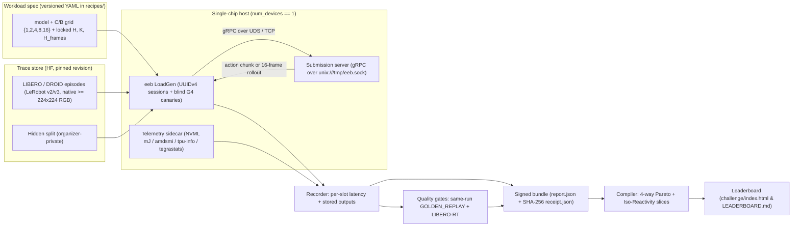

# EEB Engineering Plan (v1.0 Locked Specification)

> [!IMPORTANT]
> **Canonical v1.0 Spec Authority (`docs/DESIGN_DECISIONS.md` D1-D10):**
> * **Owner:** EEAI Benchmark Committee
> * **Division:** **Closed Division only** (`division == "CLOSED"`) at v1.0 launch (Open Division deferred to v2.0 per `V2-1`; Embodied Omni track `Qwen3-Omni-30B-A3B` deferred per `V2-2`), enforcing the **Host-CPU Neural Offload Ban** (100% of neural forward-pass operators on the 1 target accelerator) and **Closed `stream_chunk_frames` Ban** (`stream_chunk_frames = None` / `0`).
> * **Track 1 (`VLA_TRACK`: Vision-Language-Action Control, Separate Track 1A & 1B Award Pools):**
>   - **Track 1A: $\pi_{0.5}$ (`pi05-3b` / `pi05_libero`, `openpi` PyTorch via `TorchTPU`/`CUDA`/`ROCm` & native JAX/XLA):** locked `horizon H = 10`, `execute_horizon K = 5`, `dt_ms = 50.0` (20 Hz servo clock), 10 Euler flow-matching steps, dual `224x224` RGB (`timed_calls >= 320`, `warmup >= 20`, `runs >= 3`).
>   - **Track 1B: `nvidia/GR00T-N1.7-3B` / `nvidia/GR00T-N1.7-LIBERO` (PyTorch via `TorchTPU`/`CUDA`/`ROCm`):** locked `horizon H = 16`, `execute_horizon K = 8`, `dt_ms = 50.0` (20 Hz servo clock), 16 DiT denoising steps, dual `256x256` RGB (`timed_calls >= 320`, `warmup >= 20`, `runs >= 3`).
> * **Track 2 (`WM_TRACK`: Action-Conditioned World Models):**
>   - **`nvidia/Cosmos-Predict2.5-2B` (PyTorch `diffusers` via `TorchTPU`/`CUDA`/`ROCm` & optional JAX `vidax`):** locked `horizon_frames = 16` (`256x256` RGB, `dt_ms = 41.67` at 24 FPS, 10 steps, `CFG = 1.0`, `stream_chunk_frames = None`, `timed_calls >= 200`, `warmup >= 20`, `runs >= 3`); sole real-time eligibility cutoff is `p99 Rollout Rate >= 1.5 Rollouts/s` (`24.0 Stream FPS`, $L_{p99} \le 666.7\text{ ms}$), and under full bidirectional 3D-DiT rollout honest single-stream $\text{TTFF}_{p99}(1) \equiv L_{\text{clip}}$ is co-reported strictly as a `D7` diagnostic (never a `<= 100 ms` fail gate in v1.0 Closed Division).
> * **Wire Protocol:** **gRPC over Unix Domain Sockets (`unix:///tmp/eeb.sock`) or loopback TCP** (`eeb/protocol/eeb.proto` with `Caps.execute_horizon = 13`).
> * **Canonical Disambiguated Pareto Axes & Anti-Gaming (`D4`, `D5`, `D9`, `D10`):**
>   - **X-Axis:** **`p99 Chunk Rate (Chunks/s) [1000 / L_p99, ms]`** with gapless real-time cutoff at **4.0 Chunks/s** ($p99 \le 250\text{ ms}$, Track 1A) and **2.5 Chunks/s** ($p99 \le 400\text{ ms}$, Track 1B), and **`p99 Prediction Rate (Predictions/s) [1000 / L_p99, ms]`** with real-time cutoff at **1.0 Predictions/s** ($p99 \le 1000\text{ ms}$, Track 2), scored from pooled steady-state $p_{99}(C)$ across active slots paired with a mandatory `<= 15%` per-slot fairness fence.
>   - **Y-Axis:** Steady-state wall-clock **Executed Actions/sec** (`executed_actions_per_sec`, Track 1) and **Generated Frames/sec** (`generated_frames_per_sec`, Track 2) across the 4 SemiAnalysis normalizations (`Raw/Chip`, `Per-Watt` requiring live `MEASURED` hardware telemetry via `nvmlDeviceGetTotalEnergyConsumption` in `mJ`, `tegrastats`, or `amd-smi` for official awards, `Per-$/hr Reference TCO Rate`, and `Iso-100-Dense-BF16-TFLOPS` under canonical `FP32-accum`).
>   - **LoadGen Anti-Gaming (`D10`):** Native wire resolution ($\ge 224\times 224$), opaque random `UUIDv4` `session_id`s, `~5%` inline blind `GOLDEN_REPLAY` + `G4` canaries, per-slot quota $N_{\text{slot}} = \lceil N/C \rceil$ with keep-alive drain ($N \ge 320$ VLA, $N \ge 200$ WM, `warmup >= 20`, `runs >= 3`), and cross-run variance gates $\le 5\%$ on `p50`/throughput and $\le 8\%$ on `p99` tail latency across 3 runs.

## 0. TL;DR

1. **Production `eeb/` harness & reference servers ship ready for Founding Season submissions.** The `eeb/` package implements the gRPC/UDS client-server LoadGen, `EmbodiedX-Traces-v1` LeRobot trace loader, hardware telemetry sidecar, single-chip envelope checker, and turnkey reference servers (`Pi05Policy`, `Pi05JaxPolicy`, `Gr00tN17Policy`, `CosmosPredict25Policy`, `CosmosPredict25JaxPolicy`) spanning `TorchTPU`, `CUDA`, `ROCm`, and optional native `JAX/Flax`. At Day-1 v1.0 launch, `submissions/` opens clean (`0` pre-populated baseline curves) for Founding Season community and organizer benchmark submissions.
2. **Harness:** participants serve their model behind the `eeb.v1.Policy` gRPC service over Unix Domain Sockets (`unix:///tmp/eeb.sock`) or TCP (`eeb/protocol/eeb.proto`). LoadGen replays native-resolution `EmbodiedX-Traces-v1` LIBERO/DROID episodes across concurrency $C, B \in \{1, 2, 4, 8, 16\}$ using an unpaced asymptotic sweep by default (plus optional `--paced` think-time arrival pacing at `execute_horizon * dt_ms`).
3. **Quality is checked in the same execution:** stored outputs are compared against `BF16` golden reference outputs (`GOLDEN_REPLAY` gate, with `normalized_action_jerk` tracked for Track 1 and `CosSim >= 0.990` / `PSNR >= 28.0 dB` for Track 2). `SANITY_ONLY` runs without `--golden` are marked `quality_certified = False` and rejected under `eeb measure --strict` unless `--allow-sanity-only` is explicitly passed.
4. **Submissions are PRs** carrying a declarative recipe (or standalone measured bundle), server code/Dockerfile, and cryptographically signed `receipt.json`. Organizers re-run entries on reference single-chip hardware to promote `PENDING` to `CERTIFIED` (ADR-005).

***

## 1. Locked Decisions (`docs/DESIGN_DECISIONS.md` D1–D10)

| Topic | Decision |
|---|---|
| Division | **Closed Division only** (`division == "CLOSED"`) for v1.0 (Open Division deferred to v2.0 per `V2-1`; Embodied Omni track deferred per `V2-2`). |
| Tracks | (1) `VLA_TRACK` (Vision-Language-Action Control, separate 1A & 1B pools); (2) `WM_TRACK` (Action-Conditioned World Models). |
| Canonical v1.0 Models | Track 1A: **$\pi_{0.5}$ (`pi05-3b` / `pi05_libero`, $H=10, K=5$, $10$ steps, `224x224`)**. Track 1B: **`nvidia/GR00T-N1.7-3B` ($H=16, K=8$, $16$ steps, `256x256`)**. Track 2: **`nvidia/Cosmos-Predict2.5-2B` ($H_{\text{frames}}=16$, $10$ steps, `CFG=1.0`, `256x256`, `stream_chunk_frames=None`)**. |
| Hardware | One chip, native and uncapped (`CAP_SINGLE_CHIP`): `num_devices == 1`, $\le 64\text{ GB}$ memory, $\le 1{,}000\text{ dense BF16 TFLOPS}$ ($\le 2{,}000\text{ FP8/INT8 TOPS}$), $\le 2.0\text{ TB/s}$. |
| Wire Protocol | **gRPC over Unix Domain Sockets (`unix:///tmp/eeb.sock`) or loopback TCP** (`eeb/protocol/eeb.proto` with `Caps.execute_horizon = 13`). |
| Metrics | Concurrency sweep ($C, B \in \{1, 2, 4, 8, 16\}$), X = `p99 Chunk Rate (Chunks/s)` (VLA) or `p99 Rollout Rate (Rollouts/s)` (WM), Y = **Executed Actions/sec** (`executed_actions_per_sec`, Track 1) or **Generated Frames/sec** (`generated_frames_per_sec`, Track 2) across 4 SemiAnalysis normalizations (`Raw/Chip`, `Per-Watt`, `Iso-100-TOPS`, `Per-$/hr`). |
| Data | Real open-source robot episodes (`EmbodiedX-Traces-v1`: `lerobot/libero` + `lerobot/droid_1.0.1`) packed at native model resolution (`224x224` and `256x256`). |

***

## 2. Architecture

### 2.1 Serving Contract (`eeb/protocol/eeb.proto`)

- **Transport:** gRPC over Unix Domain Sockets (`unix:///tmp/eeb.sock`) or TCP (`eeb/protocol/eeb.proto`).
- `Capabilities` RPC returns `track`, `horizon`, `execute_horizon` (field 13), `dt_ms`, `precision`, `model_id`, and `server_impl`.
- `Predict` RPC serves Track 1 (`VLA_TRACK`) action chunks; `Rollout` server-streaming RPC serves Track 2 (`WM_TRACK`) generated 16-frame video rollouts (`stream_chunk_frames = None` in Closed Division, so `ttff_p99_ms == rollout_latency_p99_ms` is recorded honestly under `D7`).

### 2.2 LoadGen & Sweep Protocol

| Scenario | What it measures |
|---|---|
| `SingleStream` | $C = 1$ (or $B = 1$), pure single-stream tail latency $L_{p99}(1)$. |
| `ConcurrencySweep` | $C, B \in \{1, 2, 4, 8, 16\}$ concurrent workers (unpaced continuous queuing by default, or optional `--paced` at $P = K \cdot \Delta t$). |
| `CutoffQualification` | Highest output on the Pareto frontier meeting the real-time reactivity cutoff (`p99 Chunk Rate >= 20.0 Chunks/s` for Track 1; `p99 Rollout Rate >= 1.5 Rollouts/s` = `24.0 Stream FPS` at $L_{p99} \le 666.7\text{ ms}$ for Track 2). |

- **Per point:** `warmup >= 30` calls per session, `timed_calls >= 320` chunks (Track 1, $\ge 20$/slot at $C=16$) or `timed_calls >= 200` rollouts (Track 2) per run with per-slot quota $N_{\text{slot}} = \lceil N/C \rceil$ + keep-alive drain, `runs >= 3` per concurrency level; cross-run spread gated at $\le 5\%$ on `p50`/throughput and $\le 8\%$ on pooled steady-state `p99` tail latency (with `slot_count_spread <= 15%`).

### 2.3 Metrics

| | Track 1 (`VLA_TRACK`) | Track 2 (`WM_TRACK`) |
|---|---|---|
| Unit of work | 1 request: dual RGB + proprio + prompt → 1 action chunk ($H=10, K=5$ for $\pi_{0.5}$; $H=16, K=8$ for `GR00T-N1.7-3B`) | 1 action-conditioned rollout → $H_{\text{frames}}=16$ generated `256x256` frames |
| X axis: interactivity | **`p99 Chunk Rate (Chunks/s)`** $= 1000 / L_{p99\text{,ms}}$ (cutoff $\ge 20.0\text{ Chunks/s}$, $p99 \le 50\text{ ms}$) | **`p99 Rollout Rate (Rollouts/s | 16x FPS)`** $= 1000 / L_{p99\text{,ms}}$ (cutoff $\ge 1.5\text{ Rollouts/s} = 24.0\text{ Stream FPS}$, $p99 \le 666.7\text{ ms}$; $\text{TTFF}_{p99} \equiv L_{\text{clip}}$ diagnostic `D7`) |
| Y axis: throughput | Steady-state wall-clock **Executed Actions/s/chip** (`executed_actions_per_sec`) | Steady-state wall-clock **Generated Frames/s/chip** (`generated_frames_per_sec`) |
| Iso-Reactivity slices | `10, 20, 30, 50 Chunks/s` | `1.5, 3.0, 5.0, 10.0 Rollouts/s` |
| Energy | Actions/Joule from live `MEASURED` device power (`UNAVAILABLE`/`null` when sensor unexposed) | Frames/Joule from live `MEASURED` device power (`UNAVAILABLE`/`null` when sensor unexposed) |

### 2.4 Data & Licenses

| Use | Source (pinned HF revision) | License tag |
|---|---|---|
| VLA perf traces and Gate A | `physical-intelligence/libero` / `lerobot/libero` (LeRobot format) | CC-BY-4.0 / Apache-2.0 |
| Real-world camera & Track 2 rollouts | Subset of `lerobot/droid_1.0.1` | Apache-2.0 |
| Closed-loop Gate B | LIBERO MuJoCo simulator | MIT |

***

## 3. Workstreams & Ownership

| Workstream | Scope | Owner |
|---|---|---|
| WS1 Harness | gRPC/UDS protocol, LoadGen, recorder, hardware envelope, telemetry sidecar | EEAI Benchmark Committee |
| WS2 Data & quality | Native-resolution LeRobot trace loader, Gates G1–G4, forward-only `LIBERO-RT` | EEAI Benchmark Committee |
| WS3 Reference bring-up | 3 canonical v1.0 models across Cloud TPU, NVIDIA CUDA/Jetson, and AMD ROCm | EEAI Benchmark Committee |
| WS4 Results & submissions | SKU table, SHA-256 receipts, validator, Pareto compiler, `/challenge/` dashboard, CI | EEAI Benchmark Committee |
| WS5 Rules & community | Locked decisions (`D1`–`D10`), 10-page methodology paper, workshop website | EEAI Benchmark Committee |

***

## 4. Appendix: External Software & Model Facts Verified

- **openpi** (Apache-2.0): reference JAX/Flax and PyTorch checkpoints for $\pi_{0.5}$ (`pi05_libero`, license tag `gemma`, $H=10, K=5$, $224\times 224$).
- **Isaac-GR00T** (Apache-2.0): `nvidia/GR00T-N1.7-3B` / `nvidia/GR00T-N1.7-LIBERO` ($H=16, K=8$, $16$ DiT steps, $256\times 256$).
- **Cosmos-Predict2.5** (NVIDIA Open Model License): `nvidia/Cosmos-Predict2.5-2B` bidirectional 3D-DiT Video2World model ($H_{\text{frames}}=16$, $256\times 256$, $24\text{ FPS}$).
- **Harness & ecosystem licenses:** LeRobot Apache-2.0; LIBERO MIT; SemiAnalysis InferenceX Apache-2.0 (`InferenceX-app` is GPL-3.0 and is never forked or linked; the EmbodiedX `/challenge/` explorer is written clean-room from scratch).
