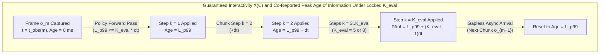

# EmbodiedX Real-Time Embodied AI Inference Benchmark Literature Review and Specification

Official benchmark methodology and literature synthesis for `embodied-efficiency-bench` (`eeb` v1.0.0) at the CoRL 2026 Workshop on Efficient Foundation Models for Real-Time Embodied AI ([EEAI @ CoRL 2026](https://efficient-embodied-ai.github.io/challenge/)).

***

## 1. Motivation and Season 1 Design Summary

Embodied AI foundation models span Vision-Language-Action (VLA) policies ($\pi_0$ [6], $\pi_{0.5}$ [7], `GR00T N1 / N1.7-3B` [8], `SmolVLA` [24]) and action-conditioned world models (`Cosmos-Predict2.5-2B` [25], `Genie Envisioner` [27]). Recent systems work accelerates these models through custom device kernels (`Pallas`, `Triton`, `CUDA`), cross-frame visual token caching (`VLA-Cache` [42]), low-bit quantization and compression (`FP8`, `INT8`, `INT4`, `EfficientVLA` [43, 52, 53]), and asynchronous action-chunk scheduling (`RTC` [10], `TT-RTC` [18], `VLASH` [17]).

Standard robotics leaderboards evaluate policies in stop-and-wait simulators where physics pauses during neural inference. Under a frozen simulation clock, a $2{,}000\text{ ms}$ policy and a $20\text{ ms}$ policy incur identical zero actuation delay, which hides physical failures caused by object slip or contact drift during inference. Meanwhile, modern ML serving benchmarks such as **SemiAnalysis InferenceX (InferenceMAX) [1, 2]** and **MLPerf Inference [35]** measure **Throughput (`tok/s/chip`) vs. Interactivity (`tok/s/user`)** Pareto frontiers for token streaming, whose axis definitions break down under receding-horizon action chunking and closed-loop actuator deadlines.

**EmbodiedX (`embodied-efficiency-bench` v1.0.0)** addresses this measurement gap for the CoRL 2026 EEAI Workshop. Season 1 evaluates every submission on a single physical accelerator chip (`num_devices == 1`, `TP = PP = EP = 1`) across two standardized cloud platforms (`NVIDIA L40S 48 GB` / `nvidia_l40s_48gb` and `Google Cloud TPU v6e-1 32 GB` / `tpu_v6e_1_32gb`). All evaluation traces are fetched deterministically from public real-world datasets (`HuggingFaceVLA/libero` and `lerobot/droid_100`), with zero synthetic sine-wave traces permitted in submissions. Under Option A launch neutrality, Season 1 opens on October 30, 2026 with `0` organizer-seeded vendor benchmark entries so community pull requests establish the founding Pareto frontier directly.

### 1.1 Ten Architectural Decisions for EmbodiedX v1.0.0

EmbodiedX enforces ten architectural decisions (**`D1` to `D10`**, summarized in [`docs/DESIGN_DECISIONS.md`](./DESIGN_DECISIONS.md)):

1. **`D1` Closed and Open Divisions Under Locked `K_eval` and Host-CPU Offload Ban.** Both `Closed` and `Open` divisions lock the execution horizon $K_{\text{eval}}$ ($5$ actions on Track 1A, $8$ actions on Track 1B, $16$ predicted frames per rollout prediction on Track 2) so aggregate output cannot be inflated by lengthening open-loop horizons. In both divisions, $100\%$ of neural forward-pass operators (`MatMul`, `Attention`, `Conv`, `MLP`, `VAE`, text encoders) inside timed `act()` and `rollout()` calls must execute on the single target accelerator; host CPU threads perform only I/O, tokenization, RPC dispatch, and action queuing, while constant episode prompt embeddings may be pre-cached on the accelerator during untimed `reset()`. **Closed Division** fixes checkpoint architecture and pretrained weights at reference denoising step counts under BF16/FP16/FP8 numerics checked by inline Golden-IO parity (`--num-samples >= 100` real trace samples with mean plus `CVaR-1%` tail floors) and forbids pseudo-causal sub-clip frame slicing (`stream_chunk_frames > 0`) on Track 2. **Open Division** permits INT4 quantization, pruning, step distillation, or token merging when paired with a signed Stage-2 quality receipt.
2. **`D2` Three Independent Track Pools Anchored to Gapless Real-Time SLAs and Pinned Checkpoints.** A $20\text{ Hz}$ robot controller steps every $\Delta t = 50\text{ ms}$ ($20.0\text{ Chunks/s}$ single-tick ceiling). Executing $K_{\text{eval}}$ actions spans $K_{\text{eval}} \Delta t$, setting each track's non-starvation deadline:
   * **Track 1A (`pi0.5-LIBERO`):** Physical Intelligence $\pi_{0.5}$ [7] at canonical ungated checkpoint `lerobot/pi05_libero_finetuned_v044` (commit `7152f13e34c6c115d808aea0e5d08aca74eac14b`, with pre-fit normalizers; $10$ Euler ODE steps, dual `224x224` RGB traces from `HuggingFaceVLA/libero` commit `86958911c0f959db2bbbdb107eb3e17c5f9c798e`, $H = 10$, locked $K_{\text{eval}} = 5$, $\approx 0.734\text{ TF/action}$), gapless SLA **`p99 <= 250.0 ms` (`>= 4.0 Chunks/s`)**. Both `PyTorch` (`CUDA` / `TorchTPU`) and `openpi` `JAX` are certified reference runtimes.
   * **Track 1B (`GR00T N1.7-3B`):** NVIDIA `GR00T N1.7-3B` [8] at `nvidia/GR00T-N1.7-LIBERO` (`libero_10` checkpoint, commit `2ea293aa20ba7cf5bbf3ba17a5fbcb1a01cbfe21`; `Cosmos-Reason2-2B` VLM + $16$-step DiT flow head, dual `256x256` RGB traces from `HuggingFaceVLA/libero`, $H = 16$, locked $K_{\text{eval}} = 8$, $\approx 0.404\text{ TF/action}$), gapless SLA **`p99 <= 400.0 ms` (`>= 2.5 Chunks/s`)**. Track 1A and Track 1B maintain separate award pools because `GR00T N1.7-3B` executes $1.82\times$ fewer FLOPs per action than $\pi_{0.5}$.
   * **Track 2 (`Cosmos-Predict2.5-2B`):** NVIDIA `Cosmos-Predict2.5-2B` [25] at `nvidia/Cosmos-Predict2.5-2B` (`robot/action-cond` action-conditioned checkpoint, commit `85f8ae7bfe8f5525c8d103429524dcf12f98bf7b`; bidirectional 3D-DiT video world model, $10$ steps, $\text{CFG} = 1.0$, `256x256` RGB manipulation traces from `lerobot/droid_100` commit `87301a2d2e99340e2010c9ef0f1d8e780b08aaf9`, locked $K_{\text{eval}} = 16$ predicted frames per rollout prediction), gapless SLA **`p99 <= 1000.0 ms` (`>= 1.0 Pred/s`)**.
3. **`D3` Quality Verification as a Hard Admissibility Gate.** Golden parity sets require `--num-samples >= 100` real trace samples. In **Closed**, Track 1 requires inline Golden-IO $\text{CosSim} \ge 0.995$ plus $\text{CVaR-1\%}$ floor, and Track 2 requires $\text{SSIM} \ge 0.88$, $\text{PSNR} \ge 26.0\text{ dB}$, $\text{CVaR-1\%}(\text{SSIM}) \ge 0.80$, and $\text{CVaR-1\%}(\text{PSNR}) \ge 22.0\text{ dB}$. In **Open**, Track 1 requires a signed Stage-2 receipt showing latency-coupled `LIBERO-RT` closed-loop success within $-5.0\text{ pp}$ of the BF16 reference under actuation delay $d = \lceil L / \Delta t \rceil$; Track 2 requires $\text{SSIM} \ge 0.88$, $\text{PSNR} \ge 26.0\text{ dB}$, $\text{CVaR-1\%}(\text{SSIM}) \ge 0.80$, $\text{CVaR-1\%}(\text{PSNR}) \ge 22.0\text{ dB}$, $\text{LPIPS} \le 0.12$, $\text{FVD} \le 120$, inverse-dynamics consistency $\text{InvDyn} \ge 0.99$, and policy-ranking correlation $\text{Kendall }\tau \ge 0.80$.
4. **`D4` Ordered Concurrency Grid, Pooled Tail Latency, Fairness Fence, and Stock-TDP Discipline.** The closed-loop load generator sweeps canonical concurrencies $C \in \{1, 2, 4, 8, 16\}$ starting at $C = 1$ (monotonic tail truncation on device OOM only; zero off-grid concurrencies and zero curve interpolation). Each point runs $N = 3$ trials measuring pooled steady-state $L_{p99}(C)$ across active slots ($N \ge 320$ chunks/run on Track 1, $N \ge 200$ predictions/run on Track 2, with untimed keep-alive drain) paired with a mandatory $\le 15\%$ per-slot completion fairness fence, within $\le 8\%$ inter-run $p99$ spread ($\le 5\%$ on $p50$/throughput) and $p99 / p50 \le 1.5$ at $C = 1$. Entrants warm up on the real model workload (`--warmup >= 30`) at stock vendor boost clocks and stock TDP first; SM clocks are locked via `nvidia-smi -lgc` (calibrated strictly on the live model loop instead of synthetic GEMM power burners) only when dynamic boost trips the variance gate, and above-stock TDP or clock overrides are banned.
5. **`D5` Disambiguated Interactivity and Throughput Axes.** X plots Guaranteed Interactivity $X(C) = 1000 / L_{p99}(C)$ in `Chunks/s` (Track 1) or strictly `Predictions/s` (Track 2, with locked $K_{\text{eval}} = 16$ frames per rollout prediction). Y plots Fleet Throughput in steady-state wall-clock `Actions/s` (Track 1) or strictly `Predictions/s` (Track 2), alongside measured energy efficiency in `Actions/J` or `Predictions/J` (`10 Hz NVML` constant-cap board power on `L40S`; `TPU v6e-1 = N/A`) plus auxiliary `$/hr` and Roofline `Iso-Compute` / `Iso-Bandwidth` views.
6. **`D6` and `D7` Forward-Only Async Closed-Loop Timing and Diagnostic Telemetry.** `LIBERO-RT` applies delay $d = \lceil L / \Delta t \rceil$ under a forward-only async loop without forcing $+27\%$ `IT-RTC` `vjp` backpropagation overhead [10, 18]. Every point co-reports Peak Age of Information $\Delta_{\text{peak}}(C, K_{\text{eval}}) = L_{p99}(C) + (K_{\text{eval}} - 1)\Delta t$ ($\text{ms}$), $p99/p50$, $\max/p50$, per-slot completion fairness skew ($\le 15\%$), normalized action jerk, $\text{TTFF}_{p99} \equiv L_{\text{clip}}$ (Track 2), and peak accelerator memory ($\text{GB}$).
7. **`D8`, `D9`, and `D10` Standardized Cloud Hardware, Three Scalar Awards, and Two-Phase Commit-Reveal.** Season 1 standardizes strictly on `NVIDIA L40S (48 GB)` (`nvidia_l40s_48gb`) and `Google Cloud TPU v6e-1 (32 GB)` (`tpu_v6e_1_32gb`). Each track crowns winners across **Interactive Reactivity (`C = 1`)**, **Real-Time Fleet Throughput**, and **Green Embodied Efficiency** (tie-broken by lower-step Real-Time Dominated Hypervolume wrt $(0.5 X_{\text{SLA}}, 0)$). Per-frame cryptographic $\pm 1/255$ `uint8` micro-jitter plus $\max / p50 \le 4.0$ prevent trace memoization, and Final Official Season 1 Awards are ranked strictly by Phase-2 organizer clean-hardware re-runs on a private held-out split (`+/- 8%` vs. Phase 1 acts strictly as an anti-fraud disqualification gate).

***

## 2. Throughput versus Tail Interactivity in Closed-Loop Control

Serving LLMs trades aggregate **Throughput (`tok/s/chip`)** against per-user **Interactivity (`tok/s/user`)** [1, 2]. Serving embodied policies and world models obeys an analogous physical tension between **Fleet Throughput (`Actions/s` or `Predictions/s`)** and **Guaranteed Interactivity (`1000 / p99_ms`)** across concurrency $C \in \{1, 2, 4, 8, 16\}$ (`D5`):

* **Guaranteed Interactivity (X-Axis, Right is Faster):** Captures pooled steady-state $p99$ completion rate across concurrent active streams $C \in \{1, 2, 4, 8, 16\}$ paired with the $\le 15\%$ per-slot completion fairness fence:
  $$X_{\text{VLA}}(C) = \frac{1000}{L_{p99}(C)} \quad [\text{Chunks/s}], \qquad X_{\text{WM}}(C) = \frac{1000}{L_{p99,\text{WM}}(C)} \quad [\text{Predictions/s}]$$
  where $L_{p99}(C)$ is pooled steady-state $p99$ request latency in $\text{ms}$ across $N \ge 320$ chunks (Track 1) or $N \ge 200$ rollout predictions of $K_{\text{eval}} = 16$ frames each (Track 2).
* **Fleet Throughput and Energy Efficiency (Y-Axis, Up is Higher):** Captures steady-state full-occupancy wall-clock output under locked horizon $K_{\text{eval}}$:
  $$Y_{\text{VLA}}(C) = \frac{N_{\text{timed}}(C) \cdot K_{\text{eval}}}{T_{\text{steady}}(C)} \quad [\text{Actions/s}], \qquad Y_{\text{WM}}(C) = \frac{N_{\text{timed}}(C)}{T_{\text{steady}}(C)} \quad [\text{Predictions/s}]$$
  paired with hardware-measured energy efficiency $E(C) = Y(C) / \bar{P}_{\text{board}}(C)$ in `Actions/J` or `Predictions/J` (`D5`, `D9`).

### 2.1 Single-Stream Reactivity versus Batched Amortization

In SemiAnalysis `InferenceMAX` [1], a sports car concentrates engine power on one passenger for minimal latency while a transit bus amortizes fuel over many passengers for high aggregate throughput. Embodied serving exhibits two corresponding regimes across $C \in \{1, 2, 4, 8, 16\}$:

1. **Single-Stream Reactive Regime (`C = 1`).** Dedicating one accelerator to a single control stream maximizes $X(1) = 1000 / L_{p99}(1)$ and minimizes closed-loop actuation delay $d = \lceil L / \Delta t \rceil$ for fast disturbance rejection when grasped objects slip [10, 17]. At $C = 1$, 2B to 3.3B parameter weights make inference largely memory-bandwidth-bound on a single chip.
2. **Batched Multi-Stream and Parallel Planning Regime (`C in {2, 4, 8, 16}`).** Raising $C$ corresponds to serving multiple arms from an edge workstation, sampling parallel action chunks as in `BID` [10], or rolling out $C$ candidate action futures during Model Predictive Control with `Cosmos-Predict2.5-2B` [25]. Weight reuse across the batch lifts `Actions/s`, `Predictions/s`, and `Actions/J` until queuing and compute grow batch latency beyond each track's real-time $p99$ deadline.

### 2.2 Discrete Concurrency Sweeps and Non-Dominated Frontiers

Single-point metrics invite batch-size tuning that trades away control responsiveness. Under `D4`, contestants evaluate one engine per track over the ordered canonical grid $C \in \{1, 2, 4, 8, 16\}$ starting at $C = 1$. Retaining only SLA-compliant discrete points produces an empirical latency-throughput Pareto frontier without synthetic interpolation between unmeasured concurrencies.

***

## 3. Differences Between Token Streaming and Action Chunking

In **SemiAnalysis InferenceX [1, 2]** and **AgentX [3]**, autoregressive LLM decoding emits one token per forward pass per sequence (or $1 + \gamma$ accepted tokens under speculative decoding). Embodied control departs from token streaming along two physical dimensions.

### 3.1 Prediction Horizon versus Locked Execution Horizon

Visuomotor policy architectures originating with **ACT [4]** and **Diffusion Policy [5]** distinguish two temporal horizons:

* **Prediction Horizon ($H$ or $T_p$).** Total future actions emitted by the network head in one forward pass ($H = 100$ at $50\text{ Hz}$ in **ACT [4]**; $H = 16$ in **Diffusion Policy [5]**; $H = 10$ on LIBERO in **$\pi_0$ [6]** and **$\pi_{0.5}$ [7]**; $H = 16$ in **GR00T N1 / N1.7-3B [8]**; $H = 8$ in **OpenVLA-OFT [9]**; DCT-compressed horizons in **FAST [46]**). Predicting a longer window stabilizes multimodal action training.
* **Execution Horizon ($K_{\text{eval}}$ or $T_a$, $1 \le K_{\text{eval}} \le H$).** Number of actions sent to the robot controller before capturing a fresh observation and issuing the next chunk request. The tail $H - K_{\text{eval}}$ steps are discarded or blended [4, 10]. EmbodiedX locks $K_{\text{eval}}$ across both `Closed` and `Open` divisions ($K_{\text{eval}} = 5$ for Track 1A, $K_{\text{eval}} = 8$ for Track 1B, $K_{\text{eval}} = 16$ frames for Track 2).

> [!IMPORTANT]
> **Throughput Counts Executed Actions ($K_{\text{eval}}$) Exclusively.**  
> Scoring raw emitted tensor length $H / \bar{L}$ would grant a DROID-configured $\pi_{0.5}$ head ($H = 50, K_{\text{eval}} = 5$) [7] a $5\times$ higher score than the LIBERO $\pi_{0.5}$ head ($H = 10, K_{\text{eval}} = 5$) at identical forward latency purely by emitting $45$ discarded actions. Counting $K_{\text{eval}}$ isolates physical actions delivered to the control loop.

### 3.2 Actuation Delay and Physical Observation Staleness

Standard manipulation suites (**LIBERO [11]**, **SimplerEnv [12]**, **CALVIN [13]**, **BEHAVIOR-1K [14]**) pause simulator physics during neural inference, and distributed benchmarks such as **RoboArena [47]** restrict attention to quasi-static tasks tolerant of network latency. Real-time robot learning research shows why zero-delay simulation fails to predict deployment behavior:

* **Delayed-MDP Control Theory.** **Ramstedt & Pal (NeurIPS 2019) [15]**, **Xiao et al. (ICLR 2020) [16]**, **DCAC (ICLR 2021) [49]**, and **Riemer et al. (2024) [50]** model concurrent control as a delayed Markov Decision Process in which physical state advances throughout inference.
* **Real-Time Action Chunking.** **RTC (Black, Galliker, & Levine, NeurIPS 2025) [10]** demonstrates that inference latency $L$ at control period $\Delta t$ delays chunk arrival by $d = \lceil L / \Delta t \rceil$ ticks; naive chunk concatenation or **Temporal Ensembling [4]** induces severe torque jumps under multi-step delay. **Streaming Flow Policy [51]** emits actions progressively along flow trajectories to lower first-action delay.
* **Delay-Sweep Degradation Studies.** **VLASH [17]**, **TT-RTC [18]**, and **Agouzoul (2026) [19]** sweep $d \in [0, 20]$ ticks on LIBERO and Kinetix and observe sharp task-success drops once observation staleness exceeds task contact windows.
* **Asynchronous Evaluation Harnesses.** **AllenAI `vla-evaluation-harness` (RFC-0001 & RFC-0007, 2026) [20]** steps simulators asynchronously against wall-clock time to report `RT Success Rate` and `Stale Action Ratio`.

***

## 4. Prior Literature and Benchmark Landscape

We review 68 papers across six research areas underlying EmbodiedX v1.0.0.

### 4.1 Action-Chunked VLA Policies and Unit Disambiguation

Generalist visuomotor policies span three architecture classes:

1. **CVAE and Parallel Regression Heads.** **ACT [4]** predicts $H = 100$ joint targets via a Conditional VAE. **OpenVLA-OFT [9]** ($H = 8$, $72.9\text{ ms}$ on A100), 1-bit **BitVLA [56]** ($K = 25$, $73\text{ ms}$), and dual-rate **FiS-VLA [57]** ($K = 8$, $68.0\text{ ms}$ on RTX 4090) emit parallel action chunks in one pass.
2. **Diffusion and Flow-Matching Heads.** **Diffusion Policy [5]** denoises $T_p = 16$ steps while executing $T_a = 8$. Track 1A model **$\pi_{0.5}$ [7]** (extending **$\pi_0$ [6]**, evaluated at `lerobot/pi05_libero_finetuned_v044`) pairs PaliGemma with a $300\text{M}$ flow-matching action expert integrating $10$ Euler ODE steps ($H = 10$, locked $K_{\text{eval}} = 5$ at dual `224x224` RGB on `HuggingFaceVLA/libero`). Track 1B model **`GR00T N1.7-3B` [8]** (evaluated at `nvidia/GR00T-N1.7-LIBERO`, `libero_10`) couples a `Cosmos-Reason2-2B` VLM with a $16$-step DiT flow action head ($H = 16$, locked $K_{\text{eval}} = 8$ at dual `256x256` RGB on `HuggingFaceVLA/libero`). **TinyVLA [58]** and **SmolVLA [24]** target compact GPUs, and **Streaming Flow Policy [51]** streams actions mid-integration.
3. **Token Compression and Runtime Acceleration.** **FAST [46]** compresses chunks via DCT and BPE. Surveys by **Guan et al. [52]** and **Yu et al. [53]** categorize inference speedups from adaptive token reuse (**VLA-Cache [42]**), early exit (**DeeR-VLA [33]**), token and layer pruning (**EfficientVLA [43]**), action caching (**FlashVLA [44]**), and speculative decoding (**Spec-VLA [45]**). **Zhang, Qi, & Zheng [54]** document discrepancies between physical ALOHA task completion time and static simulation success.

#### Three Incompatible Meanings of `"Hz"` Across 2024 to 2026 VLA Papers

Recent VLA papers apply the label `"Hz"` to three distinct quantities separated by a factor of $K$:

| Literature Convention | Representative Works | $K$ / $H$ | Reported Forward Latency $L$ | Paper `"Hz"` Figure | Chunk Rate $1/L$ (EmbodiedX **X**) | Action Rate $K/L$ (EmbodiedX **Y** at $C=1$) |
| :--- | :--- | :---: | :---: | :---: | :---: | :---: |
| **Camp A: `"Hz" = K / L`** *(Open-Loop Action Rate)* | **OpenVLA-OFT [9]** **BitVLA [56]** **FiS-VLA [57]** | $K=8$ $K=25$ $K=8$ | `72.9 ms` (1 cam) `321 ms` / `73 ms` `68.0 ms` (4090) | **`109.7 Hz`** **`77.9`** / **`341.1 Hz`** **`117.7 Hz`** | `13.7 Chunks/s` `3.1` / `13.7 Chunks/s` `14.7 Chunks/s` | `109.7 Act/s` `77.9` / `341.1 Act/s` `117.7 Act/s` |
| **Camp B: `"Hz" = 1 / L`** *(Chunk Completion Rate)* | **VLA-Cache [42]** **EfficientVLA [43]** | CogACT $\pi_0$ ($H=50$) | `54.3 -> 39.6 ms` `85.8 -> 50.1 ms` | **`12.42 -> 14.66 Hz`** **`11.65 -> 19.96 Hz`** | `12.42 -> 14.66 Chunks/s` `11.65 -> 19.96 Chunks/s` | Does not multiply by $H$ |
| **Camp C: Latency in `ms` vs. `1/dt` Servo Clock** | **$\pi_0$ [6], $\pi_{0.5}$ [7], RTC [10], TT-RTC [18]** **GR00T [8], SmolVLA [24], TinyVLA [58], VLASH [17], A2C2 [55]** | $H=50, K=5$ $H=16, K=8$ | `27-100 ms` `63.9 ms` (L40 BF16) | Servo clock fixed at **`20-50 Hz`**; latency in **`ms`** or delay $d = \lceil L/\Delta t \rceil$ | `15.6 Chunks/s` (GR00T L40) | Reserves `"Hz"` for servo loop |

Separating **X (`Chunks/s` = $1000 / L_{p99}$)** from **Y (`Actions/s`)** eliminates this ambiguity. Under EmbodiedX axes, an `OpenVLA-OFT+` checkpoint taking $321\text{ ms}$ at $K = 25$ [56] records $X = 3.1\text{ Chunks/s}$ and $Y(1) = 77.9\text{ Actions/s}$ instead of appearing faster than a $50\text{ ms}$ policy running at $X = 20.0\text{ Chunks/s}$.

### 4.2 Asynchronous and Real-Time VLA Execution

In **RTC [10]**, test-time flow inpainting (`IT-RTC`) preserves continuity across delayed chunks but introduces vector-Jacobian product (`vjp`) backpropagation through the denoising network (`+27%` latency cost). **TT-RTC [18]** and closed-form boundary blending dispense with test-time `vjp`, motivating **Decision `D6`** (forward-only asynchronous overlap in `LIBERO-RT` compatible with static `TorchTPU`, `XLA`, and `TensorRT` graphs). **VLASH [17]** forward-simulates proprioceptive state to $t + d\Delta t$, and **A2C2 [55]** applies lightweight per-step residual corrections. Whereas prior real-time control papers inject synthetic step delays $d$ on a single stream and **AllenAI `vla-evaluation-harness` [20]** relies on host OS sleeps without multi-stream concurrency or hardware energy metering, EmbodiedX couples measured hardware latency across $C \in \{1, 2, 4, 8, 16\}$ directly to real-time SLAs and latency-coupled simulation.

### 4.3 Age of Information in Feedback Control

**Kaul, Yates, & Gruteser (IEEE INFOCOM 2012) [21]** define instantaneous Age of Information $\Delta(t) = t - u(t)$ from sensor capture time $u(t)$ and prove that minimizing $\Delta(t)$ differs mathematically from maximizing throughput or minimizing queueing delay alone. **Costa, Codreanu, & Ephremides (IEEE TIT 2016) [22]** introduce **Peak Age of Information (PAoI)** for worst-case excursion prior to update arrival, and **Yates & Kaul (IEEE TIT 2019) [48]** plus **Yates et al. (IEEE JSAC 2021) [23]** extend PAoI to $C$ streams sharing a processor in closed-loop estimation and LQG control.

### 4.4 Manipulation and Perturbation Robustness Benchmarks

While **LIBERO [11]**, **SimplerEnv [12]**, **CALVIN [13]**, and **BEHAVIOR-1K [14]** score task completion under static conditions, **LIBERO-Plus [28]** shows VLA success dropping from $95\%$ below $30\%$ under camera and object perturbations, and **VLA-Arena (ICML 2026) [29]** standardizes graded visual and language perturbation suites. EmbodiedX incorporates dynamic input sensitivity directly into measurement via cryptographic pixel micro-jitter and inline `G4` perturbation canaries (`D10`).

### 4.5 World-Model Regimes and Video Simulation Benchmarks

Interactive world models fall into four architectural regimes: (1) **Causal Streaming Video DiTs** (`Diffusion Forcing` [59], `CausVid` [60], `Self Forcing` [61]) using causal distillation and rolling KV caches; (2) **Frame-Causal Neural Game Engines** (`GameNGen` [62], `Matrix-Game 2.0` [63]); (3) **Bidirectional Full-Clip 3D-DiTs** (`Cosmos-Predict2.5-2B` [25], `Sparse VideoGen` [64], `Radial Attention` [65]), where all $K_{\text{eval}} = 16$ frames attend bidirectionally across time before 3D-VAE decoding so $\text{TTFF} \equiv L_{\text{clip}}$; and (4) **Batched MPC Planners** (`DINO-WM` [66], `Genie Envisioner` [27]) scoring $C$ candidate action sequences in parallel. Offline world-model benchmarks (**1X Challenge [36]**, **EWMBench [38]**, **WorldScore [39]**, **WorldArena 1.0/2.0 [40, 41]**) omit tail-latency SLAs, batched throughput sweeps, and Joule efficiency. EmbodiedX sets a gapless Track 2 deadline of $L_{p99,\text{WM}} \le 1000.0\text{ ms}$ ($\ge 1.0\text{ Pred/s}$ for $K_{\text{eval}} = 16$ predicted frames) while supporting causal distillation in `Open` provided submissions pass all five Stage-2 fidelity and ranking gates.

### 4.6 ML Systems Energy and Roofline Methodology

**MLPerf Inference [35]** established `Closed` and `Open` divisions and `LoadGen` traffic rules, and **SemiAnalysis InferenceX [1, 2]** plus **AgentX [3]** introduced concurrency-swept Pareto curves. In robotics systems, **MAVBench [67]** coupled UAV latency to flight energy, **RobotPerf [37]** measured pre-VLA ROS 2 graphs, and **ManiSkill3 [68]** scaled batched GPU simulation without policy tail-latency sweeps. For energy and hardware normalization, EmbodiedX builds on **MLPerf Power [30]**, **ML.ENERGY (NeurIPS 2025) [31]**, **Hugging Face AI Energy Score [32]**, **DeeR-VLA [33]**, and the **Roofline Model (Williams, Waterman, & Patterson, CACM 2009) [34]**.

### 4.7 Cross-Benchmark Comparison Matrix

| Benchmark / Framework | Domain | Latency-Coupled Sim | Locked $K_{\text{eval}}$ + PAoI | Discrete $C$ Pareto Sweep | Metered Energy (`Act/J` / `Pred/J`) | Anti-Gaming + Quality Gates | Standardized Cloud GPU + TPU |
| :--- | :--- | :---: | :---: | :---: | :---: | :---: | :---: |
| **LIBERO [11] / SimplerEnv [12] / CALVIN [13]** | VLA Manipulation | No (Frozen sim) | No | No | No | Yes (Static SR) | No |
| **ManiSkill3 [68] / BEHAVIOR-1K 2026 [14]** | GPU Sim / Household VLA | No (Sim time) | No | Partial (Sim FPS) | No | Yes (SR / Q-score) | No (1 GPU) |
| **MAVBench [67] / RobotPerf [37]** | UAV / ROS 2 Compute | Partial (Pre-VLA) | No | No | Partial (MAVBench) | No | Partial (CPU/GPU/FPGA) |
| **LIBERO-Plus [28] / VLA-Arena [29]** | VLA Perturbations | No (Frozen sim) | No | No | No | Yes (Perturbed SR) | No |
| **RTC [10] / TT-RTC [18] / VLASH [17] / A2C2 [55]** | Real-Time VLA | Yes (Step delay $d$) | Partial (Synthetic $d$) | No ($C=1$ / BID) | No | Yes (Delayed SR) | No (Single GPU) |
| **AllenAI `vla-evaluation-harness` [20]** | Real-Time VLA Eval | Yes (Wall sleep) | Partial (Stale ratio) | No | No | Partial (Off-table) | No (1x H100) |
| **EWMBench [38] / WorldScore [39] / WorldArena [40, 41]** | Embodied World Models | No (Offline) | No | No | No | Yes (Visual / Dyn) | No |
| **MLPerf Inference & Power [30, 35]** | General ML Systems | No (Open-loop) | No | Partial (2 modes) | Yes (PTDaemon) | Separate accuracy run | Yes (Multi-vendor) |
| **SemiAnalysis InferenceX / AgentX [1-3]** | LLM / Agentic Serving | No (Token streams) | No | Yes ($C$ sweep) | Partial (Modeled) | Separate eval jobs | Yes (GPU / TPU) |
| **ML.ENERGY [31]** | GenAI Energy | No (Open-loop) | No | Yes (Batch sweep) | Yes (GPU `J/req`) | No | Partial (GPUs) |
| **EmbodiedX v1.0.0 (`embodied-efficiency-bench`)** | **Real-Time VLA & World Models** | **Yes ($d = \lceil L/\Delta t \rceil$)** | **Yes ($K_{\text{eval}} \in \{5,8,16\}$)** | **Yes ($C \in \{1,2,4,8,16\}$)** | **Yes (`10 Hz NVML` on `L40S`)** | **Yes (Inline + Stage-2 + Commit-Reveal)** | **Yes (`NVIDIA L40S` & `TPU v6e-1`)** |

***

## 5. Axis Formulation and Hardware Normalizations

### 5.1 Guaranteed Interactivity and Peak Age of Information

#### 5.1.1 Pooled Steady-State Tail Rate and Fairness Fence

To keep high-concurrency $p99(C)$ statistically well-conditioned ($N \ge 320$ chunks on Track 1, $N \ge 200$ predictions on Track 2) while preventing LIFO schedulers from starving one robot stream (`D4`, `D10`), EmbodiedX evaluates pooled steady-state $L_{p99}(C)$ across active slots paired with a mandatory $\le 15\%$ per-slot completion fairness fence across $C \in \{1, 2, 4, 8, 16\}$ (`D5`):

$$X_{\text{VLA}}(C) = \frac{1000}{L_{p99}(C)} \quad [\text{Chunks/s}], \qquad X_{\text{WM}}(C) = \frac{1000}{L_{p99,\text{WM}}(C)} \quad [\text{Predictions/s}]$$

With $\Delta t = 50\text{ ms}$ ($20\text{ Hz}$), the gapless real-time boundaries sit at $X_{\text{SLA}} = 4.0\text{ Chunks/s}$ ($L_{p99} \le 250.0\text{ ms}$) on Track 1A ($K_{\text{eval}} = 5$), $X_{\text{SLA}} = 2.5\text{ Chunks/s}$ ($L_{p99} \le 400.0\text{ ms}$) on Track 1B ($K_{\text{eval}} = 8$), and $X_{\text{SLA}} = 1.0\text{ Pred/s}$ ($L_{p99,\text{WM}} \le 1000.0\text{ ms}$) on Track 2 ($K_{\text{eval}} = 16$ frames per rollout prediction), while $20.0\text{ Chunks/s}$ ($50.0\text{ ms}$) marks single-tick VLA reaction.

#### 5.1.2 Peak Age of Information Derivation

Given sensor capture time $u(t)$, instantaneous observation age at the actuator is $\Delta(t) = t - u(t)$ [21]. On the final step $k = K_{\text{eval}}$ of chunk $m$, worst-case **Peak Age of Information (PAoI) [22, 23]** equals:

$$\Delta_{\text{peak}}(C, K_{\text{eval}}) = \operatorname{p99}_{m}\!\big(t_{\text{act}}(m, K_{\text{eval}}) - t_{\text{obs}}(m)\big) = L_{p99}(C) + (K_{\text{eval}} - 1)\Delta t_{\text{eff}} \quad [\text{ms}]$$

Whenever an engine satisfies its gapless SLA ($L_{p99}(C) \le K_{\text{eval}} \Delta t$) under forward-only asynchronous overlap (`D6`), zero inter-chunk queue stall occurs ($\Delta t_{\text{eff}} = \Delta t = 50\text{ ms}$). Under locked $K_{\text{eval}}$, $\Delta_{\text{peak}}(C, K_{\text{eval}})$ is a strictly decreasing function of $X_{\text{VLA}}(C)$, so ranking by $X_{\text{VLA}}(C)$ preserves exact PAoI ordering within each track.

### 5.2 Fleet Throughput and Hardware Normalizations

#### 5.2.1 Steady-State Action and Prediction Throughput

Across $C \in \{1, 2, 4, 8, 16\}$ over the steady-state full-occupancy window $T_{\text{steady}}(C)$ (saturated via untimed keep-alive requests so early-finishing slots never drain batch occupancy, and verified by the $\le 15\%$ per-slot completion fairness fence), primary Fleet Throughput is:

$$Y_{\text{VLA}}(C) = \frac{N_{\text{timed}}(C) \cdot K_{\text{eval}}}{T_{\text{steady}}(C)} \quad [\text{Actions/s}], \qquad Y_{\text{WM}}(C) = \frac{N_{\text{timed}}(C)}{T_{\text{steady}}(C)} \quad [\text{Predictions/s}]$$

where each Track 2 rollout prediction generates $K_{\text{eval}} = 16$ future frames.

#### 5.2.2 Power and Roofline Normalization Views

From the identical run receipt, EmbodiedX derives two primary plotted leaderboard views (`Throughput vs. Interactivity` and `Efficiency vs. Interactivity`) plus two auxiliary schema normalizations (`D5`):

| View | Formula | Literature Basis | Role in Season 1 |
| :--- | :--- | :--- | :--- |
| **1. Fleet Throughput (Per Chip)** | $Y_{\text{VLA}}(C)$ [`Actions/s`] or $Y_{\text{WM}}(C)$ [`Predictions/s`] | **InferenceX [1]**, **MLPerf [35]**, **RobotPerf [37]** | Official **Real-Time Fleet Throughput** award metric over SLA-compliant discrete points (`D9`). |
| **2. Green Embodied Efficiency (Per Joule)** | $Y(C) / \bar{P}_{\text{board}}(C)$ [`Actions/J` or `Predictions/J`] | **MLPerf Power [30]**, **ML.ENERGY [31]**, **AI Energy Score [32]**, **DeeR-VLA [33]** | Official **Green Embodied Efficiency** award metric requiring `power_provenance == "MEASURED"` via `10 Hz NVML` board TBP on `NVIDIA L40S` held at a constant power cap across all $C$ (`--assume-power-watts` rejected; `TPU v6e-1 = N/A`). |
| **3. Reference Hourly Cost Rate (Auxiliary)** | $Y(C) / (\text{Ref \$/hr})$ | **InferenceX v2 [2]** | Diagnostic comparison against pinned on-demand cloud rates (`~$0.88-$1.15/hr` L40S, `~$1.375/hr` TPU v6e-1). |
| **4. Roofline Iso-Compute and Iso-Bandwidth (Auxiliary)** | $\frac{Y(C)}{P_{\text{BF16}}/100}$, $\frac{Y(C)}{\text{BW}_{\text{peak}}}$ | **Williams et al. Roofline [34]** | Diagnostic Roofline efficiency relative to dense BF16 peak (`362.05 TF` / `864 GB/s` on L40S; `918 TF` / `1,600 GB/s` on TPU v6e-1). |

***

## 6. Hardware Targets Verification Protocol and Season 1 Governance

### 6.1 Absolute Physical Units Over Relative Speedups

Scoring relative lift ($L_{\text{base}} / L_{\text{cand}}$) over a software baseline penalizes platforms with mature reference compilers and hides real hardware execution rates [1, 35]. EmbodiedX ranks every track exclusively in physical SI units (`Chunks/s`, `Predictions/s`, `Actions/s`, `Actions/J`, `Predictions/J`) with zero organizer-seeded baseline anchors.

### 6.2 Standardized Season 1 Cloud Hardware Targets

All three benchmark models (`2B` to `3.3B` parameters) fit comfortably on a single device. Season 1 standardizes strictly on two cloud-accessible single-chip (`num_devices == 1`, `TP = PP = EP = 1`) platforms so teams compete on kernels, compilers, numerical precision, and serving schedulers and organizers can re-run finalists on identical silicon:

1. **Standard GPU (`nvidia_l40s_48gb`).** `NVIDIA L40S` (`Ada Lovelace SM89`, `48 GB` GDDR6 at `864 GB/s`, `350 W` TDP, native FP8 Tensor Cores, `362.05 TF` dense BF16, `10 Hz NVML` board power). Accessible via Shadeform (`~$0.88-$1.15/hr`), AWS EC2 `g6e.xlarge`, or the NVIDIA Academic Grant Program.
2. **Standard TPU (`tpu_v6e_1_32gb`).** `Google Cloud TPU v6e-1` (`Trillium` single-chip slice, `32 GB` HBM2e at `1,600 GB/s`, `918 TF` dense BF16, `1,836 TOPS` INT8/FP8, isolated via `TPU_CHIPS_PER_HOST_BOUNDS=1,1,1 TPU_HOST_BOUNDS=1,1,1 TPU_VISIBLE_DEVICES=0`). Accessible via Google Cloud (`~$1.375/hr`) or free via a renewable 30-day Google TPU Research Cloud (TRC) allocation.

### 6.3 Closed and Open Quality Gates and Scalar Award Categories

Each track (`Track 1A`, `Track 1B`, `Track 2`) crowns winners across three scalar categories:

1. **Interactive Reactivity (`C = 1`).** Highest $1000 / L_{p99}(1)$ at $C = 1$ (tie-broken by lowest $L_{p50}(1)$; requires $L_{p99}(1) / L_{p50}(1) \le 1.5$).
2. **Real-Time Fleet Throughput.** Highest aggregate `Actions/s` (Track 1) or `Predictions/s` (Track 2) across canonical points $C \in \{1, 2, 4, 8, 16\}$ satisfying the gapless pooled $p99$ SLA ($\le 250.0\text{ ms}$ on Track 1A, $\le 400.0\text{ ms}$ on Track 1B, $\le 1000.0\text{ ms}$ on Track 2) and the $\le 15\%$ per-slot fairness fence.
3. **Green Embodied Efficiency.** Highest `MEASURED` hardware `Actions/J` or `Predictions/J` across SLA-compliant canonical points (`10 Hz NVML` constant-cap board power on `L40S`; `--assume-power-watts` ineligible; `TPU v6e-1 = N/A`).

Exact ties in any category are broken by exact lower-step **Real-Time Dominated Hypervolume** computed over SLA-compliant discrete points $\{(X_i, Y_i) : C_i \in \{1, 2, 4, 8, 16\},\; X_i \ge X_{\text{SLA}}\}$ with respect to reference origin $(X_{\text{ref}}, 0) = (0.5 \cdot X_{\text{SLA}}, 0)$, with zero curve interpolation.

### 6.4 Anti-Gaming Defenses and Two-Phase Commit-Reveal

* **Eight-Gate Anti-Gaming Verification (`D4`, `D10`).** The verifier enforces: (1) single-device isolation (`num_devices == 1`) at stock TDP/clocks; (2) ordered grid $C \in \{1, 2, 4, 8, 16\}$ from $C = 1$ with monotonic OOM truncation only; (3) locked $K_{\text{eval}}$ and real public traces from `HuggingFaceVLA/libero` and `lerobot/droid_100` at native wire payloads ($\ge 224\times 224$, zero synthetic sine waves); (4) opaque `UUIDv4` session IDs plus dynamically seeded per-frame cryptographic $\pm 1/255$ `uint8` pixel micro-jitter defeating output lookup tables; (5) outlier ratio fence $\max / p50 \le 4.0$, per-slot completion fairness skew $\le 15\%$, and $C = 1$ unimodality $p99 / p50 \le 1.5$; (6) $N = 3$ trial stability ($\le 8\%$ pooled $p99$ spread across $N \ge 320$ VLA / $N \ge 200$ WM calls after `--warmup >= 30` on the real workload); (7) inline Golden-IO parity over `--num-samples >= 100` samples ($\text{CosSim} \ge 0.995$ + $\text{CVaR-1\%}$ on Track 1; $\text{SSIM} \ge 0.88$, $\text{PSNR} \ge 26.0\text{ dB}$, $\text{CVaR-1\%}(\text{SSIM}) \ge 0.80$, $\text{CVaR-1\%}(\text{PSNR}) \ge 22.0\text{ dB}$ on Track 2) and `G4` perturbation canaries (`Closed`) or signed Stage-2 `LIBERO-RT` / perceptual-dynamics receipts (`Open`); and (8) cryptographic SHA-256 receipt integrity plus constant-cap `MEASURED` NVML telemetry checks.
* **Two-Phase Commit-Reveal Protocol.** In **Phase 1**, public pull requests (`eeb prepare-commit-bundle` + `eeb verify-bundle --strict`) submit only `bundle_summary.json` and `submission_meta.json` containing `recipe_commit_sha256`, the SHA-256 digest over canonical `reveal_manifest.json` (pinning OCI image `@sha256`, HF checkpoint commit SHA and shard SHA-256s, lockfile SHA-256, and launch CLI command). In **Phase 2**, within 24 hours after December 18, 2026 (`23:59 AoE`), shortlisted finalists (maximum one finalist slot per lab or organization per track and division) privately supply their matching container and `reveal_manifest.json`. Final Official Season 1 Awards are ranked strictly by Phase-2 organizer clean-hardware re-runs on a private held-out trace split; agreement within $\pm 8\%$ of Phase-1 metrics serves strictly as an anti-fraud disqualification gate.

### 6.5 End-to-End Pipeline Validation Matrix and Season 1 Schedule

| Track and Canonical Checkpoint | Locked Horizon, Trace Pool, and SLA | Division Quality Gates (`>= 100` Samples) | Validated Standard GPU (`nvidia_l40s_48gb`) and TPU (`tpu_v6e_1_32gb`) Stacks | Season 1 Seed Entries |
| :--- | :--- | :--- | :--- | :---: |
| **Track 1A: `pi0.5-LIBERO`** (`lerobot/pi05_libero_finetuned_v044`, `@7152f13e34c6`) | $H = 10, K_{\text{eval}} = 5$; `HuggingFaceVLA/libero`; `p99 <= 250.0 ms` (`>= 4.0 Chunks/s`) | **Closed:** `CosSim >= 0.995` + `CVaR-1%`; **Open:** `LIBERO-RT` within `-5.0 pp` | **L40S:** `PyTorch` (`eager` / `compile`), `10 Hz NVML`; **v6e-1:** `openpi` `JAX` and `TorchTPU`; 8 gates passed | `0` |
| **Track 1B: `GR00T N1.7-3B`** (`nvidia/GR00T-N1.7-LIBERO`, `libero_10`, `@2ea293aa20ba`) | $H = 16, K_{\text{eval}} = 8$; `HuggingFaceVLA/libero`; `p99 <= 400.0 ms` (`>= 2.5 Chunks/s`) | **Closed:** `CosSim >= 0.995` + `CVaR-1%`; **Open:** `LIBERO-RT` within `-5.0 pp` | **L40S:** `PyTorch` (`eager` / `compile`), `10 Hz NVML`; **v6e-1:** `TorchTPU` (`eager` / `compile`); 8 gates passed | `0` |
| **Track 2: `Cosmos-Predict2.5-2B`** (`nvidia/Cosmos-Predict2.5-2B`, `robot/action-cond`, `@85f8ae7bfe8f`) | $K_{\text{eval}} = 16$ frames; `lerobot/droid_100`; `p99 <= 1000.0 ms` (`>= 1.0 Pred/s`) | **Closed:** `SSIM >= 0.88`, `PSNR >= 26.0 dB`, `CVaR-1% >= 0.80 / 22.0 dB`; **Open:** + Stage-2 gates | **L40S:** `PyTorch` (`eager` / `compile`), `10 Hz NVML`; **v6e-1:** `TorchTPU` and `JAX` servers; 8 gates passed | `0` |

* **Two-Checkpoint Season 1 Calendar.** **Oct 30, 2026:** Launch. **Nov 10, 2026 (23:59 UTC):** CoRL 2026 Live Spotlight Freeze (recognized live on stage Nov 12 in Austin). **Dec 18, 2026 (23:59 AoE):** Official Season 1 Awards Freeze (+24h Phase-2 reveal; continuous rolling leaderboard in `2027+`).
* **Winner Recognition.** Verified Season 1 category winners receive **monetary prizes**, an official **CoRL 2026 EEAI Workshop Award Certificate**, **an invitation to apply for Google Cloud credits**, permanent verified leaderboard attribution, and an invitation to co-author the post-season *EmbodiedX Season 1 Systems Report*.

### 6.6 Planned Extensions Beyond Season 1

Future seasons will expand along two directions (`S2-1` and `S2-2`): (1) variable-horizon planning scored directly against Peak Age of Information $\Delta_{\text{peak}}(C, K)$ alongside sub-$100\text{ ms}$ frame-causal streaming world-model gates [59, 60, 61, 62, 63], and (2) dedicated onboard robot-module tracks, multimodal omni policies (`Qwen3-Omni-30B-A3B` [26]), and physical hardware-in-the-loop robot arenas [47].

***

## 7. References

1. **SemiAnalysis (Patel, D., et al., 2025).** *InferenceMAX (InferenceX): Open Source Inference Benchmarking Across NVIDIA Blackwell, AMD MI355X, and Cloud Accelerators.* SemiAnalysis Newsletter, Oct 9, 2025. Code: https://github.com/SemiAnalysisAI/InferenceX
2. **SemiAnalysis (Patel, D., et al., 2026).** *InferenceX v2: NVIDIA Blackwell vs. AMD vs. Hopper: Throughput, Interactivity, Provisioned Energy (pJ/tok), and TCO.* SemiAnalysis Newsletter, Feb 16, 2026. Dashboard: https://inferencex.semianalysis.com/
3. **SemiAnalysis (Patel, D., et al., 2026).** *AgentX (InferenceX v3): Multi-Turn Agentic Session Replay Benchmarking and Quality Evaluation.* SemiAnalysis Newsletter, Aug 24, 2026. Code: https://github.com/SemiAnalysisAI/agentx-harness
4. **Zhao, T. Z., Kumar, V., Levine, S., & Finn, C. (2023).** *Learning Fine-Grained Bimanual Manipulation with Low-Cost Hardware (ACT / ALOHA).* Robotics: Science and Systems (RSS 2023). `arXiv:2304.13705v1` [`cs.RO`]. https://arxiv.org/abs/2304.13705
5. **Chi, C., Xu, Z., Feng, S., Cousineau, E. A., Du, Y., Burchfiel, B., Tedrake, R., & Song, S. (2024).** *Diffusion Policy: Visuomotor Policy Learning via Action Diffusion.* The International Journal of Robotics Research (IJRR), 44(10-11), 1684–1704 (extended from RSS 2023). DOI: `10.1177/02783649241273668`. `arXiv:2303.04137v5` [`cs.RO`]. https://arxiv.org/abs/2303.04137
6. **Black, K., Brown, N., Driess, D., Esmail, A., Equi, M., Finn, C., Fusai, N., Groom, L., Hausman, K., Ichter, B., et al. (2024).** *$\pi_0$: A Vision-Language-Action Flow Model for General Robot Control.* Robotics: Science and Systems (RSS 2025). `arXiv:2410.24164v4` [`cs.LG`]. https://arxiv.org/abs/2410.24164
7. **Physical Intelligence, Black, K., Brown, N., Darpinian, J., Dhabalia, K., Driess, D., Esmail, A., Equi, M., Finn, C., Fusai, N., et al. (2025).** *$\pi_{0.5}$: a Vision-Language-Action Model with Open-World Generalization.* `arXiv:2504.16054v1` [`cs.LG`]. https://arxiv.org/abs/2504.16054
8. **NVIDIA, Bjorck, J., Castañeda, F., Cherniadev, N., Da, X., Ding, R., Fan, L., Fang, Y., Fox, D., Hu, F., et al. (2025).** *GR00T N1: An Open Foundation Model for Generalist Humanoid Robots (and Isaac-GR00T N1.5–N1.7 Releases).* `arXiv:2503.14734v2` [`cs.RO`]. https://arxiv.org/abs/2503.14734 & https://github.com/NVIDIA/Isaac-GR00T
9. **Kim, M. J., Finn, C., & Liang, P. (2025).** *Fine-Tuning Vision-Language-Action Models: Optimizing Speed and Success (OpenVLA-OFT).* Robotics: Science and Systems (RSS 2025). `arXiv:2502.19645v2` [`cs.RO`]. https://arxiv.org/abs/2502.19645
10. **Black, K., Galliker, M. Y., & Levine, S. (2025).** *Real-Time Execution of Action Chunking Flow Policies (Real-Time Chunking / RTC).* Advances in Neural Information Processing Systems (NeurIPS 2025). `arXiv:2506.07339v2` [`cs.RO`]. https://arxiv.org/abs/2506.07339
11. **Liu, B., Zhu, Y., Gao, C., Feng, Y., Liu, Q., Zhu, Y., & Stone, P. (2023).** *LIBERO: Benchmarking Knowledge Transfer for Lifelong Robot Learning.* Advances in Neural Information Processing Systems (NeurIPS 2023). `arXiv:2306.03310v2` [`cs.AI`]. https://arxiv.org/abs/2306.03310
12. **Li, X., Hsu, K., Gu, J., Pertsch, K., Mees, O., Walke, H. R., Fu, C., Lunawat, I., Sieh, I., Kirmani, S., et al. (2024).** *Evaluating Real-World Robot Manipulation Policies in Simulation (SimplerEnv).* Conference on Robot Learning (CoRL 2024). `arXiv:2405.05941v1` [`cs.RO`]. https://arxiv.org/abs/2405.05941
13. **Mees, O., Hermann, L., Rosete-Beas, E., & Burgard, W. (2022).** *CALVIN: A Benchmark for Language-Conditioned Policy Learning for Long-Horizon Robot Manipulation Tasks.* IEEE Robotics and Automation Letters (RA-L), 7(3), 7327–7334. DOI: `10.1109/LRA.2022.3180108`. `arXiv:2112.03227v4` [`cs.RO`]. https://arxiv.org/abs/2112.03227
14. **Stanford Vision and Learning Lab (2026).** *BEHAVIOR-1K Challenge 2026: Evaluation Protocol and WebSocket Policy-Server Specification.* https://behavior.stanford.edu/challenge/evaluation.html
15. **Ramstedt, S., & Pal, C. (2019).** *Real-Time Reinforcement Learning.* Advances in Neural Information Processing Systems (NeurIPS 2019). `arXiv:1911.04448v4` [`cs.LG`]. https://arxiv.org/abs/1911.04448
16. **Xiao, T., Jang, E., Kalashnikov, D., Levine, S., Ibarz, J., Hausman, K., & Herzog, A. (2020).** *Thinking While Moving: Deep Reinforcement Learning with Concurrent Control.* International Conference on Learning Representations (ICLR 2020). `arXiv:2004.06089v4` [`cs.LG`]. https://arxiv.org/abs/2004.06089
17. **Tang, J., Sun, Y., Zhao, Y., Yang, S., Lin, Y., Zhang, Z., Hou, J., Lu, Y., Liu, Z., & Han, S. (2025).** *VLASH: Real-Time VLAs via Future-State-Aware Asynchronous Inference.* `arXiv:2512.01031v2` [`cs.RO`]. https://arxiv.org/abs/2512.01031
18. **Black, K., Ren, A. Z., Equi, M., & Levine, S. (2025).** *Training-Time Action Conditioning for Efficient Real-Time Chunking (TT-RTC).* `arXiv:2512.05964v2` [`cs.RO`]. https://arxiv.org/abs/2512.05964
19. **Agouzoul, A. (2026).** *Understanding Asynchronous Inference Methods for Vision-Language-Action Models.* `arXiv:2605.08168v1` [`cs.RO`]. https://arxiv.org/abs/2605.08168
20. **Allen Institute for AI (AI2, 2026).** *`vla-evaluation-harness`: Unified Real-Time Evaluation Framework for Vision-Language-Action Models (RFC-0001 & RFC-0007).* https://github.com/allenai/vla-evaluation-harness
21. **Kaul, S. K., Yates, R. D., & Gruteser, M. (2012).** *Real-Time Status: How Often Should One Update?* Proceedings of IEEE INFOCOM 2012, pp. 2731–2735. DOI: `10.1109/INFCOM.2012.6195689`. https://doi.org/10.1109/INFCOM.2012.6195689
22. **Costa, M., Codreanu, M., & Ephremides, A. (2016).** *On the Age of Information in Status Update Systems With Packet Management (Peak Age of Information / PAoI).* IEEE Transactions on Information Theory, 62(4), 1897–1910. DOI: `10.1109/TIT.2016.2533395`. `arXiv:1506.08637v1` [`cs.IT`]. https://arxiv.org/abs/1506.08637
23. **Yates, R. D., Sun, Y., Brown, D. R., Kaul, S. K., Modiano, E., & Ulukus, S. (2021).** *Age of Information: An Introduction and Survey.* IEEE Journal on Selected Areas in Communications (JSAC), 39(5), 1183–1210. DOI: `10.1109/JSAC.2021.3065072`. `arXiv:2007.08564v1` [`cs.IT`]. https://arxiv.org/abs/2007.08564
24. **Shukor, M., Aubakirova, D., Capuano, F., Kooijmans, P., Palma, S., Zouitine, A., Aractingi, M., Pascal, C., Russi, M., et al. (2025).** *SmolVLA: A Vision-Language-Action Model for Affordable and Efficient Robotics.* `arXiv:2506.01844v1` [`cs.LG`]. https://arxiv.org/abs/2506.01844
25. **NVIDIA (2025).** *Cosmos-Predict2 and Cosmos-Predict2.5: Action-Conditioned Video2World Foundation Models for Physical AI.* https://github.com/nvidia-cosmos/cosmos-predict2.5
26. **Qwen Team (2025).** *Qwen3-Omni-30B-A3B-Instruct: Native End-to-End Multimodal Thinker-Talker Mixture-of-Experts Architecture.* https://huggingface.co/Qwen/Qwen3-Omni-30B-A3B-Instruct
27. **Liao, Y., Zhou, P., Huang, S., Yang, D., Chen, S., Jiang, Y., Hu, Y., et al. (2025).** *Genie Envisioner: A Unified World Foundation Platform for Robotic Manipulation.* `arXiv:2508.05635v3` [`cs.RO`]. https://arxiv.org/abs/2508.05635
28. **Fei, S., Wang, S., Shi, J., Dai, Z., Cai, J., Qian, P., Ji, L., He, X., Zhang, S., Fei, Z., Fu, J., Gong, J., & Qiu, X. (2025).** *LIBERO-Plus: In-depth Robustness Analysis of Vision-Language-Action Models.* `arXiv:2510.13626v3` [`cs.RO`]. https://arxiv.org/abs/2510.13626
29. **Zhang, B., Li, J., Shen, J., Zhang, Y., et al. (2025).** *VLA-Arena: An Open-Source Framework for Benchmarking Vision-Language-Action Models.* Accepted by ICML 2026. `arXiv:2512.22539v4` [`cs.RO`]. https://arxiv.org/abs/2512.22539
30. **MLCommons Power Working Group (2026).** *MLPerf Power Measurement Rules and Methodology (`power_measurement.adoc`) and Inference Rules (`inference_rules.adoc`).* https://github.com/mlcommons/inference_policies/blob/master/power_measurement.adoc
31. **Chung, J.-W., Ma, J. J., Wu, R., Liu, J., et al. (2025).** *The ML.ENERGY Benchmark: Toward Automated Inference Energy Measurement and Optimization.* Advances in Neural Information Processing Systems (NeurIPS 2025 Datasets & Benchmarks Spotlight). `arXiv:2505.06371v2` [`cs.LG`]. https://arxiv.org/abs/2505.06371
32. **Luccioni, S., Jernite, Y., & Hugging Face Team (2025).** *The AI Energy Score: Standardized GPU Energy Efficiency Benchmarking for AI Models.* https://huggingface.github.io/AIEnergyScore/
33. **Yue, Y., Wang, Y., Kang, B., Han, Y., Wang, S., Song, S., Feng, J., & Huang, G. (2024).** *DeeR-VLA: Dynamic Inference of Multimodal Large Language Models for Efficient Robot Execution.* Advances in Neural Information Processing Systems (NeurIPS 2024). `arXiv:2411.02359v1` [`cs.RO`]. https://arxiv.org/abs/2411.02359
34. **Williams, S., Waterman, A., & Patterson, D. (2009).** *Roofline: An Insightful Visual Performance Model for Multicore Architectures.* Communications of the ACM, 52(4), 65–76. DOI: `10.1145/1498765.1498785`. https://doi.org/10.1145/1498765.1498785
35. **Reddi, V. J., Cheng, C., Kanter, D., Mattson, P., Schmuelling, G., Wu, C.-J., et al. (2020).** *MLPerf Inference Benchmark.* Proceedings of the 47th ACM/IEEE Annual International Symposium on Computer Architecture (ISCA 2020), pp. 446–459. DOI: `10.1109/ISCA45697.2020.00045`. `arXiv:1911.02549v2` [`cs.LG`]. https://arxiv.org/abs/1911.02549
36. **Mereu, R., Scannell, A., Hou, Y., Zhao, Y., et al. (2025).** *Generative World Modelling for Humanoids: 1X World Model Challenge Technical Report.* `arXiv:2510.07092v1` [`cs.LG`]. https://arxiv.org/abs/2510.07092
37. **Mayoral-Vilches, V., Jabbour, J., Hsiao, Y.-S., Wan, Z., Crespo-Álvarez, M., Stewart, M., et al. (2024).** *RobotPerf: An Open-Source, Vendor-Agnostic, Benchmarking Suite for Evaluating Robotics Computing System Performance.* Proceedings of the IEEE International Conference on Robotics and Automation (ICRA 2024), pp. 8288–8297. DOI: `10.1109/ICRA57147.2024.10610841`. `arXiv:2309.09212v2` [`cs.RO`]. https://arxiv.org/abs/2309.09212
38. **Yue, H., Huang, S., Liao, Y., Chen, S., Zhou, P., Chen, L., Yao, M., & Ren, G. (2025).** *EWMBench: Evaluating Scene, Motion, and Semantic Quality in Embodied World Models.* `arXiv:2505.09694v2` [`cs.RO`]. https://arxiv.org/abs/2505.09694
39. **Duan, H., Yu, H.-X., Chen, S., Fei-Fei, L., & Wu, J. (2025).** *WorldScore: A Unified Evaluation Benchmark for World Generation.* IEEE/CVF International Conference on Computer Vision (ICCV 2025). `arXiv:2504.00983v2` [`cs.GR`]. https://arxiv.org/abs/2504.00983
40. **Shang, Y., Li, Z., Ma, Y., Su, W., et al. (2026).** *WorldArena: A Unified Benchmark for Evaluating Perception and Functional Utility of Embodied World Models.* `arXiv:2602.08971v2` [`cs.CV`]. https://arxiv.org/abs/2602.08971
41. **Shang, Y., Tang, Y., Ma, Y., Li, Z., et al. (2026).** *WorldArena 2.0: Extending Embodied World Model Benchmarking on Modality, Functionality and Platform.* `arXiv:2605.17912v1` [`cs.RO`]. https://arxiv.org/abs/2605.17912
42. **Xu, S., Wang, Y., Xia, C., Zhu, D., et al. (2025).** *VLA-Cache: Efficient Vision-Language-Action Manipulation via Adaptive Token Caching.* Advances in Neural Information Processing Systems (NeurIPS 2025). `arXiv:2502.02175v2` [`cs.RO`]. https://arxiv.org/abs/2502.02175
43. **Yang, Y., Wang, Y., Wen, Z., Luo, Z., et al. (2025).** *EfficientVLA: Training-Free Acceleration and Compression for Vision-Language-Action Models.* `arXiv:2506.10100v1` [`cs.CV`]. https://arxiv.org/abs/2506.10100
44. **Tan, X., Yang, Y., Ye, P., Zheng, J., et al. (2025).** *Think Twice, Act Once: Token-Aware Compression and Action Reuse for Efficient Inference in Vision-Language-Action Models (FlashVLA).* `arXiv:2505.21200v1` [`cs.CV`]. https://arxiv.org/abs/2505.21200
45. **Wang, S., Yu, R., Yuan, Z., Yu, C., et al. (2025).** *Spec-VLA: Speculative Decoding for Vision-Language-Action Models with Relaxed Acceptance.* Proceedings of EMNLP 2025. `arXiv:2507.22424v2` [`cs.LG`]. https://arxiv.org/abs/2507.22424
46. **Pertsch, K., Stachowicz, K., Ichter, B., Driess, D., Nair, S., Vuong, Q., Mees, O., Finn, C., & Levine, S. (2025).** *FAST: Efficient Action Tokenization for Vision-Language-Action Models.* `arXiv:2501.09747v1` [`cs.RO`]. https://arxiv.org/abs/2501.09747
47. **Atreya, P., Pertsch, K., Lee, T., Kim, M. J., et al. (2025).** *RoboArena: Distributed Real-World Evaluation of Generalist Robot Policies.* `arXiv:2506.18123v2` [`cs.RO`]. https://arxiv.org/abs/2506.18123
48. **Yates, R. D., & Kaul, S. K. (2019).** *The Age of Information: Real-Time Status Updating by Multiple Sources.* IEEE Transactions on Information Theory, 65(3), 1807–1827. DOI: `10.1109/TIT.2018.2871079`. `arXiv:1608.08622v2` [`cs.IT`]. https://arxiv.org/abs/1608.08622
49. **Ramstedt, S., Bouteiller, Y., Beltrame, G., Pal, C., & Binas, J. (2020).** *Reinforcement Learning with Random Delays (DCAC).* International Conference on Learning Representations (ICLR 2021). `arXiv:2010.02966v3` [`cs.LG`]. https://arxiv.org/abs/2010.02966
50. **Riemer, M., Subbaraj, G., Berseth, G., & Rish, I. (2024).** *Enabling Realtime Reinforcement Learning at Scale with Staggered Asynchronous Inference.* `arXiv:2412.14355v1` [`cs.LG`]. https://arxiv.org/abs/2412.14355
51. **Jiang, S., Fang, X., Roy, N., Lozano-Pérez, T., Kaelbling, L. P., & Ancha, S. (2025).** *Streaming Flow Policy: Simplifying diffusion/flow-matching policies by treating action trajectories as flow trajectories.* Conference on Robot Learning (CoRL 2025). `arXiv:2505.21851v2` [`cs.RO`]. https://arxiv.org/abs/2505.21851
52. **Guan, W., Hu, Q., Li, A., & Cheng, J. (2025).** *Efficient Vision-Language-Action Models for Embodied Manipulation: A Systematic Survey.* `arXiv:2510.17111v3` [`cs.RO`]. https://arxiv.org/abs/2510.17111
53. **Yu, Z., Wang, B., Zeng, P., Zhang, H., et al. (2025).** *A Survey on Efficient Vision-Language-Action Models.* IEEE Transactions on Pattern Analysis and Machine Intelligence (TPAMI). `arXiv:2510.24795v3` [`cs.CV`]. https://arxiv.org/abs/2510.24795
54. **Zhang, Y., Qi, Y., & Zheng, X. (2025).** *Experiences from Benchmarking Vision-Language-Action Models for Robotic Manipulation.* `arXiv:2511.11298v1` [`cs.RO`]. https://arxiv.org/abs/2511.11298
55. **Sendai, K., Alvarez, M., Matsushima, T., Matsuo, Y., & Iwasawa, Y. (2025).** *Leave No Observation Behind: Real-time Correction for VLA Action Chunks (A2C2).* `arXiv:2509.23224` [`cs.RO`]. https://arxiv.org/abs/2509.23224
56. **Wang, H., Ding, C., Zhai, S., He, X., Zhang, Y., & Liu, Y. (2025).** *BitVLA: 1-bit Vision-Language-Action Models for Robotics Manipulation.* `arXiv:2506.07530` [`cs.RO`]. https://arxiv.org/abs/2506.07530
57. **Chen, W., Chen, S., Yang, Y., Wang, Z., Jia, K., & Zhang, L. (2025).** *Fast-in-Slow: A Dual-System Foundation Model Unifying Fast Manipulation within Slow Reasoning (FiS-VLA).* `arXiv:2506.01953` [`cs.RO`]. https://arxiv.org/abs/2506.01953
58. **Wen, J., Zhu, Y., Li, J., Zhu, M., Wu, K., Xu, Z., Liu, N., Cheng, R., Shen, C., Peng, Y., Feng, F., & Tang, J. (2025).** *TinyVLA: Towards Fast, Data-Efficient Vision-Language-Action Models for Robotic Manipulation.* IEEE Robotics and Automation Letters (RA-L), 10(4), 3988-3995. DOI: `10.1109/LRA.2025.3544909`. `arXiv:2409.12514` [`cs.RO`]. https://arxiv.org/abs/2409.12514
59. **Chen, B., Martí Monsó, D., Du, Y., Simchowitz, M., Tedrake, R., & Sitzmann, V. (2024).** *Diffusion Forcing: Next-token Prediction Meets Full-Sequence Diffusion.* Advances in Neural Information Processing Systems (NeurIPS 2024). `arXiv:2407.01392` [`cs.LG`]. https://arxiv.org/abs/2407.01392
60. **Yin, T., Zhang, Q., Zhang, R., Freeman, W. T., Durand, F., Shechtman, E., & Huang, X. (2025).** *From Slow Bidirectional to Fast Causal Video Generators (CausVid).* IEEE/CVF Conference on Computer Vision and Pattern Recognition (CVPR 2025). `arXiv:2412.07772` [`cs.CV`]. https://arxiv.org/abs/2412.07772
61. **Huang, X., Li, Z., He, G., Zhou, M., & Shechtman, E. (2025).** *Self Forcing: Bridging the Train-Test Gap in Autoregressive Video Diffusion.* `arXiv:2506.08009` [`cs.CV`]. https://arxiv.org/abs/2506.08009
62. **Valevski, D., Leviathan, Y., Arar, M., & Fruchter, S. (2025).** *Diffusion Models Are Real-Time Game Engines (GameNGen).* International Conference on Learning Representations (ICLR 2025). `arXiv:2408.14837` [`cs.LG`]. https://arxiv.org/abs/2408.14837
63. **He, X., Peng, C., Liu, Z., Wang, B., Zhang, Y., Cui, Q., Kang, F., Jiang, B., An, M., Ren, Y., Xu, B., Guo, H.-X., Gong, K., Wu, C., Li, W., Song, X., Liu, Y., Li, Y., & Peng, Y. (2025).** *Matrix-Game 2.0: An Open-Source, Real-Time, and Streaming Interactive World Model.* `arXiv:2508.13009` [`cs.CV`]. https://arxiv.org/abs/2508.13009
64. **Xi, H., Yang, S., Zhao, Y., Xu, C., Li, M., Li, X., Lin, Y., Cai, H., Zhang, J., Li, D., Chen, J., Stoica, I., Keutzer, K., & Han, S. (2025).** *Sparse VideoGen: Accelerating Video Diffusion Transformers with Spatial-Temporal Sparsity.* International Conference on Machine Learning (ICML 2025). `arXiv:2502.01776` [`cs.CV`]. https://arxiv.org/abs/2502.01776
65. **Li, X., Li, M., Cai, T., Xi, H., Yang, S., Lin, Y., Zhang, L., Yang, S., Hu, J., Peng, K., Agrawala, M., Keutzer, K., Stoica, I., & Han, S. (2025).** *Radial Attention: $\mathcal{O}(n \log n)$ Sparse Attention with Energy Decay for Long Video Generation.* Advances in Neural Information Processing Systems (NeurIPS 2025). `arXiv:2506.19852` [`cs.CV`]. https://arxiv.org/abs/2506.19852
66. **Zhou, G., Pan, H., LeCun, Y., & Pinto, L. (2025).** *DINO-WM: World Models on Pre-trained Visual Features enable Zero-shot Planning.* International Conference on Machine Learning (ICML 2025). `arXiv:2411.04983` [`cs.RO`]. https://arxiv.org/abs/2411.04983
67. **Boroujerdian, B., Genc, H., Krishnan, S., Cui, W., Faust, A., & Reddi, V. J. (2018).** *MAVBench: Micro Aerial Vehicle Benchmarking.* Proceedings of the 51st Annual IEEE/ACM International Symposium on Microarchitecture (MICRO 2018), pp. 894-907. DOI: `10.1109/MICRO.2018.00077`. `arXiv:1805.05956` [`cs.RO`]. https://arxiv.org/abs/1805.05956
68. **Tao, S., Xiang, F., Shukla, A., Qin, Y., Hinrichsen, X., Yuan, X., Bao, C., Lin, X., Liu, Y., Chan, T.-k., Gao, Y., Li, X., Mu, T., Xiao, N., Gurha, A., Rajesh, V. N., Choi, Y. W., Chen, Y.-R., Huang, Z., Calandra, R., Chen, R., Luo, S., & Su, H. (2025).** *ManiSkill3: GPU Parallelized Robotics Simulation and Rendering for Generalizable Embodied AI.* Robotics: Science and Systems (RSS 2025). `arXiv:2410.00425` [`cs.RO`]. https://arxiv.org/abs/2410.00425
