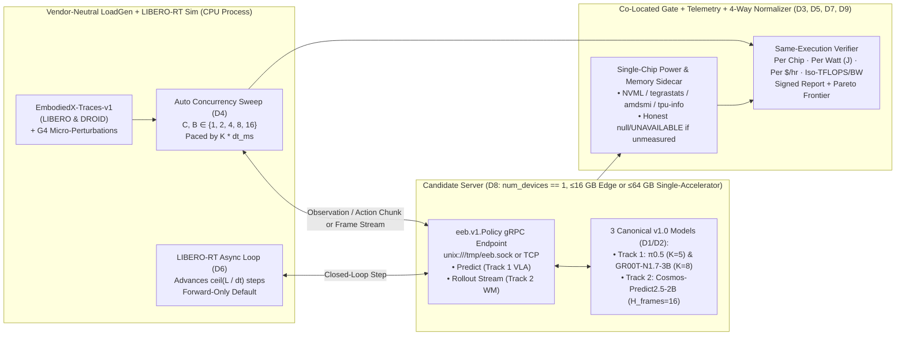

# EEAI @ CoRL 2026: `embodied-efficiency-bench` (EEB v1.0) Challenge & Living Benchmark Architecture (`D1`–`D9`)

> [!IMPORTANT]
> **Context:** Workshop = *Efficient Foundation Models for Real-Time Embodied AI (EEAI)*, CoRL 2026, **Thu Nov 12, 2026, Austin**.  
> **Specification Authority:** Locked v1.0 Design Decisions (`D1`–`D9`) in [`docs/DESIGN_DECISIONS.md`](./DESIGN_DECISIONS.md).  
> **Core Mandate:** Establish an **InferenceX & AgentX for Embodied AI** living benchmark and CoRL 2026 Challenge (`embodied-efficiency-bench` / `eeb`) built around five clean, orthogonal pillars:
> 1. **Closed Division Only for v1.0 (`D1` & `D2`):** Frozen model weights and locked execution horizons across **Two Canonical Tracks**: **Track 1 (`VLA_TRACK`: $\pi_{0.5}$ with $K=5$ and `GR00T-N1.7-3B` with $K=8$)** and **Track 2 (`WM_TRACK`: `Cosmos-Predict2.5-2B` with $H_{\text{frames}}=16$)**. *(The Open Division with model retraining / variable $K$ and the Embodied Omni Track `Qwen3-Omni-30B-A3B` are explicitly deferred to v2.0.)*
> 2. **Two Single-Chip Hardware Classes (`D8`, `num_devices == 1`, $\le 64\text{ GB}$ Native Memory):** **Onboard Edge Class ($\le 16\text{ GB}$)** (`Jetson Orin NX 16GB`, `RTX 4060 Ti 16GB`) and **Single-Accelerator Class ($\le 64\text{ GB}$)** (`Cloud TPU v6e-1 32GB`, `Jetson AGX Thor 64GB`, `RTX 5090 32GB / RTX 4090 24GB / L40S 48GB / L4 24GB`, and qualifying `ROCm` GPUs such as `AMD MI210 64GB / Radeon PRO W7900 48GB`) with 100% native uncapped execution.
> 3. **Automatic Concurrency Sweep (`D4`) & Unified SemiAnalysis InferenceX Axes (`D5`):** Sweeps $C \in \{1, 2, 4, 8, 16\}$ (Track 1) and $B \in \{1, 2, 4, 8, 16\}$ (Track 2); **X-Axis** = Per-Stream `p99 Chunk Rate` $f_{\text{react}}(C) = 1000 / L_{p99}(C)$ ($\text{Chunks/s}$, Track 1) or `p99 Rollout Rate` $f_{\text{react,WM}}(B) = 1000 / L_{p99,\text{WM}}(B)$ ($\text{Rollouts/s}$, Track 2); **Y-Axis** = Total Chip Output (`Executed Actions/sec` or `Generated Frames/sec`) across **4 selectable normalizations** (`Per Chip`, `Per Watt` in Joules, `Per $/hr Reference TCO Rate`, and `Iso-Compute (per 100 Dense BF16 TFLOPS) / Iso-Bandwidth`).
> 4. **Real Open-Source Dataset Traces (`EmbodiedX-Traces-v1`) + Default Forward-Only Async Loop (`D6`):** Preserves natural temporal redundancy ($o_t \rightarrow o_{t+1}$) across `lerobot/libero` and `lerobot/droid_1.0.1` and advances `LIBERO-RT` by $d = \lceil L / \Delta t \rceil$ steps asynchronously without forcing `vjp` backpropagation overhead.
> 5. **Vendor-Neutral Client–Server Harness (`eeb`) with Co-Located Quality Gates (`D3`), Diagnostic Telemetry (`D7`), & Physical SI Unit Awards (`D9`).**

***

## 1. Part 1: Locked v1.0 Closed Division & Two Canonical Benchmark Tracks (`D1` & `D2`)

In v1.0 (`division == "CLOSED"`), contestants do **not** retrain models, alter model architectures, or tune execution horizon $K$ / rollout length $H_{\text{frames}}$. Contestants submit an optimized inference engine (custom kernels in `Pallas` / `Triton` / `CUDA` / `ROCm`, graph compilation via `TorchTPU` `torch.compile` / `XLA` / `TensorRT`, calibrated `FP8` / `INT8` / `INT4` quantization, cross-frame visual token caching, and forward-only scheduling). Because these models have **2B to 3.3B parameters**, **every canonical v1.0 model fits natively on a single $\le 64\text{ GB}$ chip without multi-GPU tensor parallelism**:

### Track 1: Real-Time VLA Control (`VLA_TRACK`)
1. **$\pi_{0.5}$ (`pi05-3b` / `pi05_libero` / `lerobot/pi05_libero_finetuned`, `3.3B`, Locked $H = 10, K = 5$)**
   * **Architecture:** Physical Intelligence **3.3B Flow-Matching VLA** pairing a PaliGemma VLM with a **300M continuous Flow-Matching Action Expert** ($10$ reference Euler ODE integration steps, canonical LIBERO prediction horizon $H = 10$, **locked execution horizon $K = 5$** at $\Delta t = 50\text{ ms}$ / $20\text{ Hz}$, dual $224\times 224$ RGB; raw `pi0.5-base` / DROID uses $H = 50$, while the canonical LIBERO benchmark locks $H = 10, K = 5$; ~$6.6\text{ GB}$ BF16, ~$3.4\text{ GB}$ FP8).
   * **Primary Optimization Axes:** Custom `Pallas` / `Triton` / `CUDA` / `ROCm` attention and MLP kernels, static-shape `jax.jit` / `TorchTPU` `torch.compile` / `XLA` graph fusion, calibrated `FP8` / `INT8` / `INT4` quantization, cross-frame visual token caching, and forward-only asynchronous execution (`D6`).
2. **`GR00T-N1.7-3B` (`nvidia/GR00T-N1.7-LIBERO` / `nvidia/GR00T-N1.7-3B`, `3.0B`, Locked $H = 16, K = 8$)**
   * **Architecture:** **3B Dual-System Vision-Language-Action Model** coupling a `Cosmos-Reason2-2B` (`Qwen3-VL-2B`) VLM backbone with a **16-step Diffusion Transformer (DiT) continuous action head** (prediction horizon $H = 16$, **locked execution horizon $K = 8$** at $\Delta t = 50\text{ ms}$ / $20\text{ Hz}$, dual $256\times 256$ RGB; ~$6.2\text{ GB}$ BF16, ~$3.2\text{ GB}$ FP8).
   * **Primary Optimization Axes:** Fused DiT diffusion block kernels, cross-step VLM prefix/KV caching, static-camera visual token reuse, and calibrated `FP8` / `INT8` / `INT4` quantization.

### Track 2: Interactive World Models (`WM_TRACK`)
3. **`Cosmos-Predict2.5-2B` (`nvidia/Cosmos-Predict2.5-2B`, `2.0B`, Locked $H_{\text{frames}} = 16$)**
   * **Architecture:** **Action-conditioned bidirectional 3D-DiT Video2World foundation model** (PyTorch `diffusers` via `TorchTPU` / `CUDA` / `ROCm`, plus optional JAX `vidax`) generating future video/latent rollouts conditioned on `256x256` RGB frames and robot action trajectories (**locked rollout horizon $H_{\text{frames}} = 16$ frames per rollout** at $24\text{ FPS}$, $\Delta t = 41.67\text{ ms}$, $10$ steps, $\text{CFG} = 1.0$; $\text{TTFF} \equiv L_{\text{clip}}$, and `stream_chunk_frames` is prohibited in `CLOSED` division).
   * **Primary Optimization Axes:** Graph compilation (`TorchTPU` `torch.compile` / `CUDA` graphs), on-device Rule `D1` session prompt pre-encoding at `reset()`, spatio-temporal attention and 3D-VAE kernels, and calibrated low-precision (`FP8` / `INT8` / `INT4`) decoding across parallel MPC rollout batches $B \in \{1, 2, 4, 8, 16\}$ at the $\ge 1.5\text{ Rollouts/s}$ ($24.0\text{ Stream FPS}$, $L_{p99} \le 666.7\text{ ms}$) real-time cutoff.

> [!NOTE]
> **Explicitly Deferred to v2.0 (Out of Scope for v1.0 Launch):**
> * **V2-1: Open Division:** Model retraining, architectural modifications, variable execution horizon $K$, and learned asynchronous adapters (`FutureRTC`, `A2C2`, `RACE`, `RAVEL`) are deferred to v2.0 so v1.0 remains a clean, apples-to-apples systems and inference benchmark on frozen models.
> * **V2-2: Embodied Omni Model Track (`Qwen3-Omni-30B-A3B`):** Generic Thinker/Talker serving is already covered by `vLLM-Omni` and `SGLang-Omni`; deferring keeps v1.0 sharply focused on Visuomotor Control (Track 1) and World Models (Track 2).

***

## 2. Part 2: Two Single-Chip Hardware Classes (`D8`: `num_devices == 1`, $\le 64\text{ GB}$ Native Memory)

Allowing 700W–1,000W datacenter behemoths (`B200 180GB`, `H100 80GB`, `MI300X 192GB`) either turns a robotics efficiency challenge into a capital-budget arms race or requires artificial software memory-fraction caps. By right-sizing the **Single-Chip Envelope (`CAP_SINGLE_CHIP`, `num_devices == 1`)** to $\le 64\text{ GB}$ native memory, $\le 1{,}000\text{ dense BF16 TFLOPS}$ ($\le 2{,}000\text{ FP8/INT8 TOPS}$), and $\le 2.0\text{ TB/s}$ memory bandwidth, **every eligible chip runs 100% natively out-of-the-box** across two hardware classes (`D8`):

1. **Onboard Edge Class ($\le 16\text{ GB}$ Native Memory):** `NVIDIA Jetson Orin NX 16GB`, `NVIDIA RTX 4060 Ti 16GB`, and compact edge ASICs ($\le 16\text{ GB}$).
2. **Single-Accelerator Class ($\le 64\text{ GB}$ Native Memory):** `Google Cloud TPU v6e-1 32GB`, `NVIDIA Jetson AGX Thor 64GB`, `NVIDIA RTX 5090 32GB / RTX 4090 24GB / L40S 48GB / L4 24GB`, and qualifying ROCm GPUs (`AMD Instinct MI210 64GB / Radeon PRO W7900 48GB`).

| Vendor / Ecosystem | Hardware Class (`D8`) | Eligible Native Single-Chip SKUs (`num_devices == 1`) | Native Memory & Bandwidth | Typical Board Power |
| :--- | :--- | :--- | :--- | :--- |
| **Google Cloud TPU** | Single-Accelerator ($\le 64\text{ GB}$) | **`1x Cloud TPU v6e-1 (Trillium)`** | **`32 GB` HBM2e** (`1.60 TB/s`) | `~170W` |
| **NVIDIA** | Single-Accelerator ($\le 64\text{ GB}$) Onboard Edge ($\le 16\text{ GB}$) | **`1x Jetson AGX Thor 64GB`** **`1x RTX 5090 32GB` / `L40S 48GB` / `RTX 4090 24GB` / `L4 24GB`** **`1x Jetson Orin NX 16GB`** | **`64 GB` LPDDR5X** (`273 GB/s`) **`24–48 GB` GDDR7/G6X/G6** (`0.30–1.79 TB/s`) **`16 GB` LPDDR5** (`102 GB/s`) | `70–130W` `72–575W` `15–25W` |
| **AMD** | Single-Accelerator ($\le 64\text{ GB}$) | **`1x Instinct MI210 64GB`** **`1x Radeon PRO W7900 48GB`** | **`64 GB` HBM2e** (`1.64 TB/s`) **`48 GB` GDDR6** (`0.86 TB/s`) | `300W` `295W` |

***

## 3. Part 3: Automatic Concurrency Sweep (`D4`), Unified InferenceX Axes (`D5`), & Physical SI Awards (`D9`)

Contestants submit **one** engine per track behind `eeb.v1.Policy` (`unix:///tmp/eeb.sock` or TCP). The harness automatically sweeps concurrency $C \in \{1, 2, 4, 8, 16\}$ (Track 1) or rollout batch $B \in \{1, 2, 4, 8, 16\}$ (Track 2):

* **X-Axis (Right is Better $\to$):** Per-stream `p99 Chunk Rate` ($\text{Chunks/s}$, Track 1) or `p99 Rollout Rate` ($\text{Rollouts/s}$, Track 2; $16\times = \text{Stream FPS}$) (`D5`):
  $$X_{\text{VLA}}(C) = f_{\text{react}}(C) = \frac{1000}{L_{p99}(C)}, \qquad X_{\text{WM}}(B) = f_{\text{react,WM}}(B) = \frac{1000}{L_{p99,\text{WM}}(B)}$$
* **Y-Axis (Up is Better $\uparrow$):** Total Chip Output (`D5`):
  $$Y_{\text{VLA}}(C) = \frac{1000 \cdot C \cdot K}{\bar{L}(C)} \;\;[\text{Executed Actions/sec}], \qquad Y_{\text{WM}}(B) = \frac{1000 \cdot B \cdot H_{\text{frames}}}{\bar{L}_{\text{WM}}(B)} \;\;[\text{Generated Frames/sec}]$$

| Y-Axis Normalization (`D5`) | Formula & Telemetry Source | Official Award Role (`D9`) & What It Rewards |
| :--- | :--- | :--- |
| **1. Per Chip (`primary`)** | $\text{Executed Actions/sec/chip}$ (Track 1) or $\text{Generated Frames/sec/chip}$ (Track 2) | **Official Real-Time Performance Champion (`D9`):** Highest qualifying `Actions/sec/chip` or `Frames/sec/chip` at the real-time cutoff ($f_{\text{react}} \ge 20\text{ Chunks/s}$ for Track 1; $f_{\text{react,WM}} \ge 1.5\text{ Rollouts/s} = 24.0\text{ Stream FPS}$, $L_{p99} \le 666.7\text{ ms}$ for Track 2). |
| **2. Per Watt (`perfw`)** | $$\frac{Y_{\text{VLA}}(C)\text{ or }Y_{\text{WM}}(B)}{\bar{P}_{\text{active}}\text{ (Watts)}} = \text{Actions/Joule (or Frames/Joule)}$$ via `NVML`/`tegrastats`, `amdsmi`, `tpu-info` | **Official Real-Time Energy Efficiency Champion (`D9`):** Highest qualifying `Actions/Joule` or `Frames/Joule` at the real-time cutoff using immutable physical SI units. |
| **3. Per \$/hr Reference TCO Rate (`tco`)** | $$\frac{Y_{\text{VLA}}(C)\text{ or }Y_{\text{WM}}(B)}{\text{Reference Rate (\$/hr)}}$$ | **Fleet Economics View:** Interactive dashboard toggle backed by version-pinned single-chip hourly reference rates (`tco_efficiency_per_dollar`, with `throughput_per_1k_usd` retained as secondary CapEx metadata). |
| **4. Iso-Compute & Iso-Bandwidth (`isotops`)** | $$\frac{Y}{P_{\text{peak}}/100\text{ TOPS}}, \quad \frac{Y}{\text{BW}_{\text{peak}}\text{ (TB/s)}}$$ | **Compiler & Kernel Roofline Efficiency:** Isolates pure software and kernel efficiency per $100\text{ dense TOPS}$ and per $\text{TB/s}$ of memory bandwidth. |

### Co-Located Quality Gates (`D3`), Async Loop (`D6`), & Diagnostic Telemetry (`D7`)
* **Track 1 (`VLA_TRACK`) Gate (`D3`):** Action `CosSim >= 0.995` vs. `BF16` reference on `EmbodiedX-Traces-v1`, anti-memoization reactivity under `G4` $\ell_\infty$ pixel perturbation, and closed-loop `LIBERO-RT` task success within **$\le 2.0$ percentage points** of `BF16` under real-time delay $d = \lceil L / \Delta t \rceil$ using the default forward-only async loop (`D6`).
* **Track 2 (`WM_TRACK`) Gate (`D3`):** Rollout latent/pixel `CosSim >= 0.990`, `PSNR >= 28.0 dB` ($\Delta\text{FVD} \le +5\%$) vs. `BF16` reference, inverse-dynamics action controllability, 60s closed-loop rollout stability, and horizon-parity cutoff `p99 Rollout Rate >= 1.5 Rollouts/s` (`L_p99 <= 666.7 ms`, with honest `TTFF_p99 == L_clip` co-reported under `D7`).
* **Co-Reported Diagnostics (`D7`):** Every operating point reports observation staleness $\Delta_{\text{peak}}(C, K) = L_{p99}(C) + (K - 1)\Delta t_{\text{eff}}$ ($\text{ms}$), normalized action jerk (Track 1), $\text{TTFF}_{p99}$ (Track 2), and peak device memory (`GB`).

***

## 4. Part 4: Real Open-Source Dataset Traces (`EmbodiedX-Traces-v1`)

Synthetic `torch.randn` Gaussian noise tensors destroy real-world temporal optimization opportunities ($o_t \rightarrow o_{t+1}$ frame redundancy, static background token caching, and prefix KV reuse). `embodied-efficiency-bench` standardizes **`EmbodiedX-Traces-v1`**, a checksummed suite of real open-source robot episode trajectories:
1. **`LIBERO` (`lerobot/libero`: `Spatial`, `Object`, `Goal`, `Long`):** Paired with the latency-coupled `LIBERO-RT` MuJoCo simulator and deterministic trace replay for $\pi_{0.5}$ ($K=5$) and `GR00T-N1.7-3B` ($K=8$).
2. **`DROID` (`lerobot/droid_1.0.1`: Distributed Robot Interaction Dataset):** Multi-camera RGB, 7-DoF Franka arm + gripper proprioception, and natural-language instructions for evaluating $\pi_{0.5}$, `GR00T-N1.7-3B`, and `Cosmos-Predict2.5-2B` ($H_{\text{frames}}=16$).
3. **Anti-Memoization Perturbation Layer (`Gate G4`):** Injects seeded $\ell_\infty$ micro-perturbations at runtime so lookup-table memoization is impossible while legitimate temporal delta-caching works natively.

***

## 5. Part 5: Vendor-Neutral gRPC/UDS Client–Server Harness (`eeb`)

